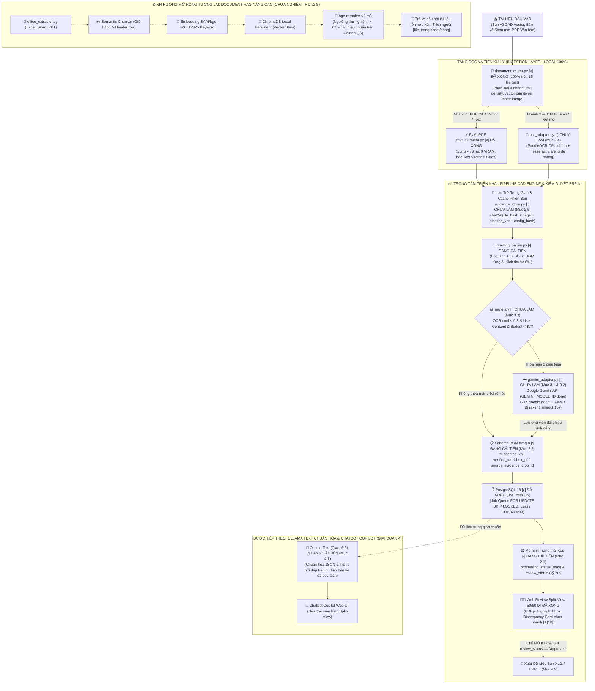
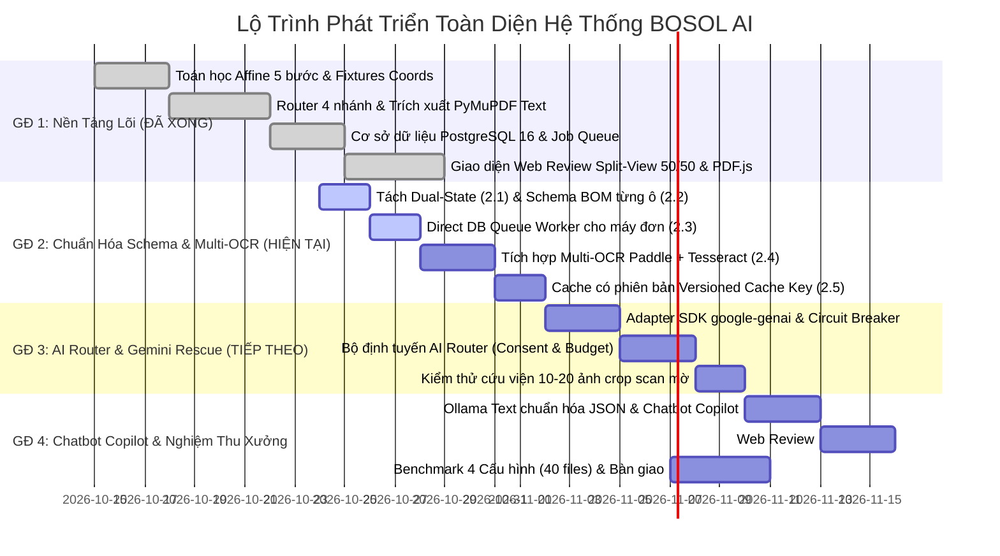

<style>
/* ====================================================================
   ĐỊNH DẠNG XUẤT BẢN & IN ẤN CHUẨN MICROSOFT WORD KỸ THUẬT
   - Phông chữ tiêu chuẩn: Times New Roman
   - Bố cục trang in: A4 Portrait, căn lề chuẩn văn bản kỹ thuật
   - Tiêu đề, đề mục: Phân cấp rõ ràng, đánh số tự động kiểu Word
   - 100% không sử dụng ký tự đánh dấu Markdown thô (#)
   ==================================================================== */

@page {
    size: A4 portrait;
    margin: 20mm 18mm 20mm 18mm;
    @top-right {
        content: "BOSOL AI • ĐẶC TẢ KỸ THUẬT v2.8/v2.9 (CAD ENGINE & ĐỊNH HƯỚNG COPILOT/RAG)";
        font-family: 'Times New Roman', Times, serif;
        font-size: 9pt;
        color: #64748b;
        font-style: italic;
    }
    @bottom-right {
        content: "Trang " counter(page);
        font-family: 'Times New Roman', Times, serif;
        font-size: 9.5pt;
        color: #475569;
    }
    @bottom-left {
        content: "LOCAL-FIRST HYBRID ENGINE • LƯU HÀNH NỘI BỘ";
        font-family: 'Times New Roman', Times, serif;
        font-size: 9pt;
        color: #64748b;
    }
}

* {
    box-sizing: border-box;
}

body {
    font-family: 'Times New Roman', Times, 'Liberation Serif', serif;
    font-size: 11pt;
    line-height: 1.45;
    color: #111827;
    background-color: #ffffff;
    margin: 0 auto;
    padding: 10px 20px;
    max-width: 900px;
    text-align: justify;
    -webkit-font-smoothing: antialiased;
}

/* Định dạng đầu đề chuẩn văn bản hành chính */
.doc-header-table {
    width: 100%;
    border: none;
    margin-bottom: 25px;
    border-collapse: collapse;
}

.doc-header-table td {
    border: none;
    padding: 0;
    vertical-align: top;
}

.header-org {
    font-size: 10.5pt;
    font-weight: bold;
    color: #0f172a;
    text-transform: uppercase;
    text-align: center;
}

.header-sub {
    font-size: 9.5pt;
    color: #475569;
    text-align: center;
    margin-top: 2px;
}

.header-line {
    width: 100px;
    height: 1px;
    background-color: #0f172a;
    margin: 4px auto 0 auto;
}

/* Tiêu đề chính văn bản */
h1, .doc-main-title {
    font-family: 'Times New Roman', Times, serif;
    font-size: 17pt;
    font-weight: bold;
    color: #0f172a;
    text-align: center;
    margin-top: 15px;
    margin-bottom: 4px;
    text-transform: uppercase;
    letter-spacing: 0.5px;
    page-break-after: avoid;
}

.doc-sub-title {
    text-align: center;
    font-size: 11pt;
    font-weight: bold;
    color: #1e3a8a;
    margin-top: 0;
    margin-bottom: 22px;
    letter-spacing: 0.2px;
}

/* Đề mục cấp 1: PHẦN (Heading 1) */
h2, .doc-heading-1 {
    font-family: 'Times New Roman', Times, serif;
    font-size: 12.5pt;
    font-weight: bold;
    color: #1e3a8a;
    border-bottom: 1.5px solid #cbd5e1;
    padding-bottom: 4px;
    margin-top: 26px;
    margin-bottom: 10px;
    text-transform: uppercase;
    page-break-after: avoid;
    break-after: avoid;
}

/* Đề mục cấp 2: MỤC CHÍNH (Heading 2) */
h3, .doc-heading-2 {
    font-family: 'Times New Roman', Times, serif;
    font-size: 11.5pt;
    font-weight: bold;
    color: #0f172a;
    margin-top: 16px;
    margin-bottom: 6px;
    page-break-after: avoid;
    break-after: avoid;
}

/* Đề mục cấp 3: MỤC CON (Heading 3) */
h4, .doc-heading-3 {
    font-family: 'Times New Roman', Times, serif;
    font-size: 11pt;
    font-weight: bold;
    color: #334155;
    margin-top: 12px;
    margin-bottom: 4px;
    page-break-after: avoid;
    break-after: avoid;
}

p {
    margin-top: 0;
    margin-bottom: 0.7em;
    text-align: justify;
}

ul, ol {
    margin-top: 0;
    margin-bottom: 0.75em;
    padding-left: 26px;
}

li {
    margin-bottom: 0.35em;
    text-align: justify;
}

strong {
    font-weight: bold;
    color: #0f172a;
}

/* Bảng biểu Word tiêu chuẩn */
table {
    width: 100%;
    border-collapse: collapse;
    font-family: 'Times New Roman', Times, serif;
    font-size: 10pt;
    line-height: 1.35;
    margin: 14px 0;
    background-color: #ffffff;
    border: 1px solid #94a3b8;
    page-break-inside: avoid;
    break-inside: avoid;
}

th {
    background-color: #f1f5f9;
    color: #0f172a;
    font-weight: bold;
    text-align: left;
    padding: 7px 10px;
    border: 1px solid #94a3b8;
    border-bottom: 2px solid #64748b;
}

td {
    padding: 6px 10px;
    border: 1px solid #cbd5e1;
    color: #111827;
    vertical-align: top;
}

tr:nth-child(even) td {
    background-color: #f8fafc;
}

/* Thẻ trạng thái & Kết quả đầu ra tiến độ */
.status-tag {
    display: inline-block;
    padding: 2px 7px;
    border-radius: 4px;
    font-size: 8.5pt;
    font-weight: bold;
    white-space: nowrap;
}
.status-done {
    background-color: #dcfce7;
    color: #166534;
    border: 1px solid #86efac;
}
.status-wip {
    background-color: #fef9c3;
    color: #854d0e;
    border: 1px solid #fde047;
}
.status-todo {
    background-color: #f1f5f9;
    color: #475569;
    border: 1px solid #cbd5e1;
}

.output-box {
    background-color: #f8fafc;
    border-left: 3px solid #16a34a;
    padding: 6px 10px;
    margin-top: 4px;
    font-size: 9pt;
    color: #0f172a;
    border-radius: 0 4px 4px 0;
}

.output-box code {
    color: #0369a1;
    font-family: 'Consolas', monospace;
    font-size: 9pt;
}

/* Khối mã nguồn & JSON */
pre {
    background-color: #f8fafc;
    color: #0f172a;
    border: 1px solid #cbd5e1;
    border-left: 4px solid #1e3a8a;
    border-radius: 4px;
    padding: 10px 14px;
    font-family: 'Consolas', 'Courier New', monospace;
    font-size: 9pt;
    line-height: 1.45;
    margin: 12px 0;
    overflow-x: auto;
    page-break-inside: avoid;
    break-inside: avoid;
}

code {
    font-family: 'Consolas', 'Courier New', monospace;
    font-size: 9.5pt;
    background-color: #f1f5f9;
    color: #b91c1c;
    padding: 1px 4px;
    border-radius: 3px;
    border: 1px solid #e2e8f0;
}

pre code {
    background-color: transparent;
    color: inherit;
    padding: 0;
    border: none;
    font-size: inherit;
}

/* Khối ghi chú Callout kiểu Word */
blockquote {
    margin: 14px 0;
    padding: 10px 16px;
    background-color: #f8fafc;
    border-left: 4px solid #1e3a8a;
    border-top: 1px solid #e2e8f0;
    border-right: 1px solid #e2e8f0;
    border-bottom: 1px solid #e2e8f0;
    border-radius: 4px;
    page-break-inside: avoid;
    break-inside: avoid;
}

blockquote p {
    margin: 4px 0;
}

blockquote strong {
    color: #1e3a8a;
}

/* Sơ đồ Mermaid & Phân cách */
.mermaid {
    text-align: center;
    margin: 16px 0;
    background-color: #ffffff;
    page-break-inside: avoid;
    break-inside: avoid;
}

hr {
    border: none;
    border-top: 1px solid #cbd5e1;
    margin: 22px 0;
}

/* Mục lục tóm tắt kiểu Word */
.toc-box {
    background-color: #f8fafc;
    border: 1px solid #cbd5e1;
    border-radius: 4px;
    padding: 12px 18px;
    margin-bottom: 24px;
    page-break-inside: avoid;
}

.toc-title {
    font-weight: bold;
    color: #1e3a8a;
    font-size: 11pt;
    margin-bottom: 8px;
    text-transform: uppercase;
}

.toc-list {
    margin: 0;
    padding-left: 20px;
    font-size: 10pt;
}

.toc-list li {
    margin-bottom: 4px;
}
</style>

<!-- KHUNG TIÊU ĐỀ CHUẨN VĂN BẢN KỸ THUẬT HÀNH CHÍNH -->
<table class="doc-header-table">
    <tr>
        <td style="width: 45%; text-align: center;">
            <div class="header-org">DỰ ÁN TỰ ĐỘNG HÓA BOSOL AI</div>
            <div class="header-sub">BỘ PHẬN KỸ THUẬT & CÔNG NGHỆ THÔNG TIN</div>
            <div class="header-line"></div>
        </td>
        <td style="width: 10%;"></td>
        <td style="width: 45%; text-align: center;">
            <div class="header-org">CỘNG HÒA XÃ HỘI CHỦ NGHĨA VIỆT NAM</div>
            <div class="header-sub">Độc lập – Tự do – Hạnh phúc</div>
            <div class="header-line"></div>
        </td>
    </tr>
</table>

<h1 class="doc-main-title">ĐẶC TẢ DỰ ÁN: HỆ THỐNG AI ĐỌC BẢN VẼ KỸ THUẬT & TÀI LIỆU HỖN HỢP</h1>
<div class="doc-sub-title">TÀI LIỆU KỸ THUẬT TRIỂN KHAI PHIÊN BẢN v2.8 (CAD ENGINE CỐT LÕI & ĐỊNH HƯỚNG COPILOT/RAG v2.9) - CẬP NHẬT 24/10/2026</div>

<table>
    <tr>
        <th style="width: 28%;">THÔNG TIN VĂN BẢN</th>
        <th style="width: 72%;">QUY ĐỊNH CHI TIẾT & THAM SỐ ÁP DỤNG</th>
    </tr>
    <tr>
        <td><strong>Tên tài liệu</strong></td>
        <td>Đặc tả kỹ thuật Hệ thống AI đọc bản vẽ kỹ thuật cơ khí & tài liệu hỗn hợp đa định dạng</td>
    </tr>
    <tr>
        <td><strong>Phiên bản chuẩn</strong></td>
        <td><strong>v2.8 / v2.9 Master Blueprint</strong> (Khớp Lộ trình 24/10/2026: CAD Engine là phạm vi triển khai hiện tại, Chatbot Copilot là bước tiếp theo, RAG nâng cao là định hướng mở rộng)</td>
    </tr>
    <tr>
        <td><strong>Tài liệu quy chiếu tiến độ</strong></td>
        <td><a href="Lo_trinh_phat_trien_va_tien_do_du_an.pdf">Lo_trinh_phat_trien_va_tien_do_du_an.pdf</a> / <a href="Lo_trinh_phat_trien_va_tien_do_du_an.md">Lo_trinh_phat_trien_va_tien_do_du_an.md</a> (Bảng theo dõi tiến độ chi tiết v2.8)</td>
    </tr>
    <tr>
        <td><strong>Tiến độ tổng thể</strong></td>
        <td><strong>Đã hoàn thành ~65% - 70%</strong> khối lượng công việc nền tảng cốt lõi (Toán học tọa độ Affine, Text-first PyMuPDF, PostgreSQL DB Queue, Web UI Split-View). Đang bước vào giai đoạn nâng cấp v2.8 (Chuẩn hóa Schema, Multi-OCR, Gemini Rescue Layer, AI Router).</td>
    </tr>
    <tr>
        <td><strong>Quy ước đánh dấu tiến trình</strong></td>
        <td>
            <span class="status-tag status-done">[x] ĐÃ HOÀN THÀNH</span> : Đã code, đã chạy kiểm thử, có kết quả đầu ra thực tế.<br/>
            <span class="status-tag status-wip">[/] ĐANG CẢI TIẾN / REFACTOR</span> : Đã có mã nguồn nhưng cần sửa đổi/đồng bộ chuẩn v2.8.<br/>
            <span class="status-tag status-todo">[ ] CHƯA LÀM (KẾ HOẠCH)</span> : Hạng mục mới cần lập trình bổ sung tiếp theo.
        </td>
    </tr>
    <tr>
        <td><strong>Mô hình vận hành</strong></td>
        <td><strong>Local-First Hybrid Architecture (Xác định rõ phân kỳ triển khai):</strong><br/>
        • <em>Phạm vi triển khai hiện tại (CAD Engine):</em> Bóc tách Khung tên, BOM từng ô với BBox, Kích thước Ø/±; Web Review Split-View 50/50; xuất dữ liệu ERP khi kỹ sư duyệt.<br/>
        • <em>Bước hoàn thiện tiếp theo (Chatbot Copilot):</em> Trợ lý ảo sử dụng Ollama Text chuẩn hóa JSON và trả lời câu hỏi dựa trên dữ liệu trung gian chuẩn đã trích xuất từ bản vẽ.<br/>
        • <em>Định hướng mở rộng tương lai (Document RAG nâng cao - Chưa thuộc phạm vi nghiệm thu v2.8):</em> Đọc tài liệu hỗn hợp (PDF, Scan, Excel, Word, PPT) $\rightarrow$ Hybrid Search (BM25 + BGE-M3) $\rightarrow$ Reranker (BGE-Reranker-v2-m3) $\rightarrow$ Chatbot trích nguồn kiểm chứng.</td>
    </tr>
    <tr>
        <td><strong>Mô hình AI cốt lõi</strong></td>
        <td><strong>Local AI cho bóc tách & chuẩn hóa:</strong> Dùng <strong>Ollama Text</strong> như lộ trình để chuẩn hóa JSON và chạy chatbot Copilot dựa trên dữ liệu trích xuất; cấu hình <strong>Qwen2.5-7B</strong> chỉ là cấu hình thử nghiệm, chưa xác nhận khả năng chạy ổn định lâu dài trên GPU 6GB (cần đo kiểm VRAM & benchmark). Multi-OCR gồm PaddleOCR CPU làm chính, Tesseract (vie+eng) dự phòng.<br/>
        <strong>Cloud Rescue (Tầng cứu viện API):</strong> Giữ <strong><code>GEMINI_MODEL_ID</code> cấu hình động</strong> (mặc định chọn model Flash thế hệ mới đang được Google hỗ trợ chính thức tại thời điểm triển khai, ví dụ <code>gemini-2.5-flash</code>; không dùng cố định các model cũ như <code>gemini-1.5-flash</code> hay bản thử nghiệm <code>gemini-2.0-flash</code> nếu đã hết hạn hỗ trợ) qua SDK chính thức <code>google-genai</code>. Áp dụng nghiêm ngặt chính sách User Consent và kiểm soát ngân sách theo lộ trình; model chính thức và mức chi phí chỉ là giả định tính toán cần đo kiểm xác minh khi triển khai thực tế trên tập crop mờ.</td>
    </tr>
    <tr>
        <td><strong>Hạ tầng & Cơ sở dữ liệu</strong></td>
        <td><strong>0 VNĐ thuê máy chủ</strong> (Chạy All-in-One trên 01 Laptop nội bộ có GPU 6GB). <strong>PostgreSQL 16</strong> là kho dữ liệu bắt buộc hiện tại (quản lý Job Queue <code>FOR UPDATE SKIP LOCKED</code>, mô hình trạng thái kép Dual-State, Duyệt BOM từng ô, ERP sync). <strong>ChromaDB Local</strong> chỉ đưa vào khi thực hiện phân hệ RAG nâng cao trong tương lai.</td>
    </tr>
    <tr>
        <td><strong>Nguyên tắc sống còn</strong></td>
        <td><strong>Tuyệt đối không bịa (Zero Blind Trust & Zero Hallucination):</strong> Tách bạch Dual-State (máy xử lý <code>processing_status</code> vs kỹ sư duyệt <code>review_status</code>); khóa cứng nút xuất ERP cho đến khi kỹ sư thực hiện hành động phê duyệt chủ động và backend kiểm tra hợp lệ; Ngưỡng từ chối điểm liên quan score &lt; 0.3 (ngưỡng thử nghiệm giả định ban đầu cho phân hệ RAG mở rộng, cần hiệu chuẩn trên Golden QA; không áp dụng cho CAD Copilot hiện tại); Chatbot đối chiếu trực tiếp trên dữ liệu trung gian chuẩn hoặc trích nguồn kiểm chứng.</td>
    </tr>
</table>

<div class="toc-box">
    <div class="toc-title">MỤC LỤC TỔNG QUAN TÀI LIỆU (15 PHẦN)</div>
    <ol class="toc-list">
        <li><strong>PHẦN 1.</strong> Phạm vi dự án và kiến trúc tổng thể (Trọng tâm CAD Engine hiện tại, Chatbot Copilot & Định hướng RAG mở rộng)</li>
        <li><strong>PHẦN 2.</strong> Hạ tầng All-in-One trên 01 Laptop và cơ chế hàng đợi Worker (Direct DB Queue)</li>
        <li><strong>PHẦN 3.</strong> Tầng AI: Ollama Text Local, Gemini Rescue Layer & SDK <code>google-genai</code> chuẩn</li>
        <li><strong>PHẦN 4.</strong> Cơ sở dữ liệu Dual-State: Quản lý bóc tách CAD, PostgreSQL 16 & Định hướng ChromaDB mở rộng</li>
        <li><strong>PHẦN 5.</strong> Toán học hệ tọa độ: Chuẩn hóa PyMuPDF BBox, Ma trận biến đổi PDF.js và giới hạn kiểm chứng Fixtures (7/7 tests mẫu theo báo cáo)</li>
        <li><strong>PHẦN 6.</strong> Tầng đọc file (Ingestion): Router 4 nhánh PDF bản vẽ, Multi-OCR và Bộ đọc Office mở rộng</li>
        <li><strong>PHẦN 7.</strong> Tầng Retrieval & RAG: Hybrid Search (BM25 + BGE-M3), Reranker (Định hướng mở rộng tương lai)</li>
        <li><strong>PHẦN 8.</strong> Cơ chế sinh câu trả lời: Ollama Text Copilot trên dữ liệu trung gian & Prompt chống bịa</li>
        <li><strong>PHẦN 9.</strong> Quy trình hệ thống toàn diện từ đầu đến cuối & Nguyên tắc Kỹ sư phê duyệt trước khi xuất ERP</li>
        <li><strong>PHẦN 10.</strong> Cấu trúc thư mục mã nguồn nâng cấp và đặc tả các module cốt lõi</li>
        <li><strong>PHẦN 11.</strong> Cơ chế cô lập sự cố Subprocess, Kế hoạch Circuit Breaker và Quản lý Timeout/Retry cho Gemini API</li>
        <li><strong>PHẦN 12.</strong> Schema dữ liệu: BOM cấp từng ô, Candidates đối chiếu bình đẳng và RAG Metadata</li>
        <li><strong>PHẦN 13.</strong> Phân tích chi phí định lượng & Bài toán giả định ngân sách (Gemini API Rescue Layer)</li>
        <li><strong>PHẦN 14.</strong> Kế hoạch kiểm thử (Benchmark CAD 4 Cấu hình trên 40 PDF + Chỉ số RAG) & Lộ trình thực hiện chi tiết 4 Giai đoạn</li>
        <li><strong>PHẦN 15.</strong> Kết luận và các quyết định thiết kế bất biến (Local-First Hybrid Architecture)</li>
    </ol>
</div>

<!-- BẢNG TỔNG HỢP CÁC NÂNG CẤP CỐT LÕI v2.8/v2.9 -->
<h3 class="doc-heading-2">BẢNG TỔNG HỢP CÁC NÂNG CẤP ĐỘT PHÁ Ở PHIÊN BẢN v2.8/v2.9 UNIFIED</h3>

<table>
    <tr>
        <th style="width: 22%;">Thành phần nâng cấp</th>
        <th style="width: 40%;">Nội dung cải tiến & Phân kỳ triển khai (Cập nhật 24/10/2026)</th>
        <th style="width: 38%;">Giá trị kỹ thuật & Nghiệp vụ thực tế</th>
    </tr>
    <tr>
        <td><strong>1. Phân định rõ phạm vi</strong></td>
        <td>Xác định <strong>CAD Engine</strong> là phạm vi triển khai và nghiệm thu hiện tại; <strong>Chatbot Copilot</strong> (dựa trên dữ liệu trung gian) là bước tiếp theo; <strong>RAG nâng cao</strong> là định hướng mở rộng (chưa thuộc phạm vi nghiệm thu v2.8).</td>
        <td>Tập trung nguồn lực giải quyết dứt điểm bài toán cốt lõi bóc tách bản vẽ kỹ thuật phục vụ sản xuất và nhập kho ERP.</td>
    </tr>
    <tr>
        <td><strong>2. Nâng cấp LLM Local</strong></td>
        <td>Sử dụng <strong>Ollama Text</strong> theo lộ trình để chuẩn hóa JSON và trả lời chat; cấu hình <strong>Qwen2.5-7B</strong> chỉ là cấu hình thử nghiệm, cần kiểm chứng VRAM và độ ổn định trên GPU 6GB.</td>
        <td>Đảm bảo an toàn tài nguyên máy trạm, không gây tràn VRAM, tối ưu hóa tốc độ chuẩn hóa dữ liệu bản vẽ.</td>
    </tr>
    <tr>
        <td><strong>3. Cứu viện Gemini API</strong></td>
        <td>Giữ <strong><code>GEMINI_MODEL_ID</code> cấu hình động</strong> (mặc định <code>gemini-2.5-flash</code> hoặc model Flash đang active theo tài liệu Google GenAI SDK tại thời điểm triển khai; không fix cứng model cũ) qua SDK <code>google-genai</code>; chính sách consent và ngân sách chặt chẽ; chi phí chỉ là giả định tính toán cần xác minh khi triển khai.</td>
        <td>Kiểm soát tối đa tính bảo mật và ngân sách doanh nghiệp; cứu viện chính xác các ô mờ, số đo khó mà OCR cục bộ đọc sai.</td>
    </tr>
    <tr>
        <td><strong>4. Cơ sở dữ liệu cốt lõi</strong></td>
        <td><strong>PostgreSQL 16</strong> là kho dữ liệu hiện tại duy nhất bắt buộc (quản lý Job Queue, mô hình Dual-State, BOM từng ô, ERP sync); <strong>ChromaDB Local</strong> chỉ đưa vào khi thực hiện RAG nâng cao.</td>
        <td>Đơn giản hóa kiến trúc hạ tầng cục bộ MVP, bảo toàn tính nguyên tử dữ liệu và hỗ trợ tốt kiểm duyệt đa người dùng.</td>
    </tr>
    <tr>
        <td><strong>5. Ingestion & Multi-OCR</strong></td>
        <td>Router 4 nhánh dựa trên text density, vector primitives và raster image; Multi-OCR (PaddleOCR CPU chính + Tesseract dự phòng); đọc Office (Excel, Word, PPT) là định hướng mở rộng RAG.</td>
        <td>Mục tiêu đạt độ chính xác phân loại cao trên các loại tài liệu bản vẽ kỹ thuật (theo báo cáo nội bộ đạt 15/15 file trên tập mẫu thử nghiệm; cần tiếp tục xác nhận độc lập trên tập bản vẽ thực tế mở rộng); giảm thiểu tối đa sai sót nhầm lẫn ký tự số đo cơ khí.</td>
    </tr>
    <tr>
        <td><strong>6. Cơ chế chống ảo giác & An toàn ERP</strong></td>
        <td>Tách bạch Dual-State (máy xử lý vs kỹ sư duyệt); BOM từng ô có BBox và ảnh crop; <strong>khóa nút xuất ERP</strong> cho đến khi kỹ sư thực hiện hành động phê duyệt chủ động và backend kiểm tra hợp lệ.</td>
        <td>Kiểm soát và hạn chế tối đa rủi ro đưa số đo sai hoặc bịa đặt vào dây chuyền sản xuất; kỹ sư luôn là người phê duyệt cuối cùng trước khi cho phép xuất dữ liệu.</td>
    </tr>
    <tr>
        <td><strong>7. Kế hoạch kiểm thử</strong></td>
        <td>Trọng tâm là <strong>Benchmark 4 cấu hình trên 40 PDF bản vẽ thực tế</strong> (accuracy, P50/P95 latency, chi phí USD, VRAM); bộ chỉ số đo lường RAG (Hit Rate, Faithfulness) áp dụng khi kích hoạt phân hệ RAG.</td>
        <td>Đo kiểm định lượng khoa học hiệu năng và tính ổn định của hệ thống trước khi nghiệm thu bàn giao xưởng.</td>
    </tr>
</table>

<hr/>

<h2 class="doc-heading-1">PHẦN 1. PHẠM VI DỰ ÁN VÀ KIẾN TRÚC TỔNG THỂ (TRỌNG TÂM CAD ENGINE HIỆN TẠI, CHATBOT COPILOT & ĐỊNH HƯỚNG RAG MỞ RỘNG)</h2>

<p>Hệ thống được thiết kế theo triết lý <strong>Local-First Hybrid Architecture</strong>, phân định rõ ràng ranh giới giữa <strong>phạm vi triển khai hiện tại</strong> theo Lộ trình v2.8 và <strong>định hướng mở rộng tương lai</strong>:</p>

<ol>
    <li><strong>Phân hệ CAD Engine (Phạm vi triển khai cốt lõi hiện tại - Giai đoạn 1 đến 3):</strong> Tập trung giải quyết bài toán trọng tâm của nhà máy sản xuất: bóc tách tự động dữ liệu hình học, bảng kê vật tư (BOM từng ô kèm Bounding Box và Evidence Crop), và khung tên từ 4 loại PDF bản vẽ cơ khí; cung cấp giao diện kiểm duyệt Web Review Split-View 50/50 hai chiều và khóa xuất dữ liệu ERP cho đến khi kỹ sư duyệt hoàn tất.</li>
    <li><strong>Chatbot Copilot Bản vẽ (Bước hoàn thiện tiếp theo - Giai đoạn 4):</strong> Sử dụng <strong>Ollama Text</strong> để chuẩn hóa cấu trúc JSON và đóng vai trò trợ lý thông minh trả lời các câu hỏi kỹ thuật của kỹ sư dựa trên <strong>dữ liệu trung gian chuẩn đã được trích xuất</strong> từ bản vẽ (Title Block, BOM, Kích thước).</li>
    <li><strong>Phân hệ Document RAG nâng cao (Định hướng mở rộng tương lai - Chưa thuộc phạm vi nghiệm thu v2.8):</strong> Kiến trúc dự kiến nhằm mở rộng năng lực đọc hiểu toàn diện kho tài liệu kỹ thuật hỗn hợp (PDF scan, bảng tính Excel bảo toàn dòng/sheet, tài liệu Word/PowerPoint), kết hợp Hybrid Search (BM25 + BGE-M3), Reranker và ChromaDB. Phân hệ này được thiết kế sẵn sàng về mặt kiến trúc nhưng chưa nằm trong phạm vi nghiệm thu của giai đoạn hiện hành.</li>
</ol>

<h3 class="doc-heading-2">1.1. Ma trận phân định tính năng và phân kỳ triển khai</h3>

<table>
    <tr>
        <th style="width: 22%;">Phân hệ & Tính năng</th>
        <th style="width: 18%;">Phân kỳ & Trạng thái</th>
        <th style="width: 30%;">Dữ liệu / Tài liệu áp dụng</th>
        <th style="width: 30%;">Đầu ra nghiệp vụ & Mục tiêu</th>
    </tr>
    <tr>
        <td><strong>Khung tên bản vẽ (Title Block)</strong></td>
        <td><span class="status-tag status-done">[x] ĐÃ XONG</span> (Text)<br/><span class="status-tag status-todo">[ ] CHƯA LÀM</span> (Scan)</td>
        <td>• Mã bản vẽ (<code>drawing_number</code>)<br/>• Tên chi tiết (<code>part_name</code>)<br/>• Vật liệu (<code>material</code>), Tỷ lệ</td>
        <td>Tự động định danh hồ sơ, lập mã sản phẩm trong kho vật tư và quản lý phiên bản thiết kế.</td>
    </tr>
    <tr>
        <td><strong>Bảng kê BOM cấp từng ô</strong></td>
        <td><span class="status-tag status-wip">[/] ĐANG CẢI TIẾN</span> (Mục 2.2)</td>
        <td>• Số thứ tự (<code>item</code>), Mã (<code>part_number</code>)<br/>• Số lượng (<code>quantity</code>), Vật liệu (<code>material</code>)<br/>• <strong>BBox, Evidence crop từng ô</strong></td>
        <td>Bóc tách chính xác từng ô dữ liệu; hiển thị trên Web Review để kỹ sư đối chiếu và khóa xuất ERP.</td>
    </tr>
    <tr>
        <td><strong>Kích thước & Dung sai (Dimensions)</strong></td>
        <td><span class="status-tag status-done">[x] ĐÃ XONG</span> (Text)<br/><span class="status-tag status-todo">[ ] CHƯA LÀM</span> (Rescue)</td>
        <td>• Kích thước bao (Dài x Rộng x Cao)<br/>• Đường kính trục/lỗ (<code>Ø</code>), Bán kính (<code>R</code>)<br/>• Dung sai (<code>±</code>, lệch trên/dưới)</td>
        <td>Xác định kích thước phôi để tính giá gia công nhanh và chỉ định máy CNC phù hợp.</td>
    </tr>
    <tr>
        <td><strong>Chatbot Copilot Bản vẽ</strong></td>
        <td><span class="status-tag status-wip">[/] ĐANG CẢI TIẾN</span> (Mục 4.1)</td>
        <td>• Trợ lý hỏi đáp trên <strong>dữ liệu trung gian đã trích xuất</strong> (Title Block, BOM, Kích thước)<br/>• Chuẩn hóa JSON bằng Ollama Text</td>
        <td>Kỹ sư tra cứu nhanh thông số bản vẽ ngay trên màn hình Split-View; không nạp vision nặng gây tràn GPU.</td>
    </tr>
    <tr>
        <td><strong>Tra cứu RAG tài liệu kỹ thuật & Hợp đồng</strong></td>
        <td><span class="status-tag status-todo">[MỞ RỘNG TƯƠNG LAI]</span> (Chưa nghiệm thu v2.8)</td>
        <td>• Thuyết minh thiết kế, tiêu chuẩn nghiệm thu<br/>• Hợp đồng, biên bản kiểm tra chất lượng</td>
        <td>Hybrid Search (BM25 + BGE-M3) + Reranker tra cứu đa tài liệu kèm trích nguồn số trang.</td>
    </tr>
    <tr>
        <td><strong>Bóc tách & Tra cứu Bảng tính Excel</strong></td>
        <td><span class="status-tag status-todo">[MỞ RỘNG TƯƠNG LAI]</span> (Chưa nghiệm thu v2.8)</td>
        <td>• Bảng định mức tiêu hao nguyên vật liệu<br/>• Bảng kê đơn giá khoán dạng Excel</td>
        <td>Truy vấn số liệu chính xác theo từng hàng, từng cột mà không bị biến dạng bảng; dẫn chiếu số dòng và sheet.</td>
    </tr>
</table>

<h3 class="doc-heading-2">1.2. Sơ đồ kiến trúc toàn trình hệ thống (Phân định trạng thái thực tế & Ưu tiên CAD Pipeline)</h3>



<hr/>

<h2 class="doc-heading-1">PHẦN 2. HẠ TẦNG ALL-IN-ONE TRÊN 01 LAPTOP VÀ CƠ CHẾ HÀNG ĐỢI WORKER (DIRECT DB QUEUE)</h2>

<p>Để đảm bảo <strong>chi phí thuê máy chủ là 0 VNĐ</strong> và dữ liệu bản vẽ bảo mật tuyệt đối bên trong nhà xưởng, toàn bộ hệ thống được tối ưu hóa để vận hành an toàn trên <strong>01 Laptop kỹ thuật thông dụng</strong> cấu hình tiêu chuẩn: CPU Intel Core i7 / AMD Ryzen 7, RAM 16GB, Card đồ họa GPU NVIDIA 6GB VRAM (RTX 3060/4050 Laptop trở lên).</p>

<h3 class="doc-heading-2">2.1. Chiến lược phân bổ tài nguyên MVP (Tránh nghẽn RAM 16GB & GPU 6GB)</h3>

<p>Trong giai đoạn MVP, để đảm bảo hệ thống chạy mượt mà và không xảy ra tình trạng tràn bộ nhớ (Out-Of-Memory - OOM) hay treo máy trạm, hệ thống áp dụng nguyên tắc <strong>chạy ít worker và không nạp đồng thời nhiều mô hình nặng</strong>:</p>

<ul>
    <li><strong>OCR Engine chạy ít Worker:</strong> Chỉ sử dụng <strong>1–2 worker CPU</strong> để xử lý tuần tự từng trang bản vẽ; không bật 4–6 worker ồ ạt làm cạn kiệt RAM và băng thông CPU của hệ điều hành.</li>
    <li><strong>Điều phối mô hình tuần tự:</strong> Khi pipeline CAD đang chạy bóc tách hình ảnh, tuyệt đối không nạp đồng thời các mô hình Embedding (bge-m3) hay Reranker.</li>
    <li><strong>Ollama Text nạp theo nhu cầu:</strong> Mô hình Ollama Text chỉ được gọi tuần tự khi cần chuẩn hóa JSON sau OCR hoặc khi kỹ sư mở cửa sổ Chatbot Copilot; không duy trì thường trực trên VRAM nếu máy cần ưu tiên xử lý đồ họa bản vẽ nặng.</li>
</ul>

<table>
    <tr>
        <th style="width: 25%;">Thành phần tiến trình</th>
        <th style="width: 25%;">Công nghệ & Kích thước model</th>
        <th style="width: 25%;">Mức tiêu thụ VRAM / RAM</th>
        <th style="width: 25%;">Phương thức tối ưu hóa MVP</th>
    </tr>
    <tr>
        <td><strong>LLM Local (Ollama Text)</strong></td>
        <td>Ollama Text (Qwen2.5-7B là cấu hình thử nghiệm)</td>
        <td>~4.0 - 4.2 GB VRAM (khi nạp)</td>
        <td>Quantization 4-bit; nạp theo nhu cầu; cần đo kiểm VRAM thực tế trước khi chốt cố định.</td>
    </tr>
    <tr>
        <td><strong>OCR Engines</strong></td>
        <td>PaddleOCR CPU (chính) + Tesseract 5 (dự phòng)</td>
        <td>0 MB VRAM (~1.0 - 1.5 GB RAM)</td>
        <td>Chỉ chạy 1–2 CPU worker tuần tự, giải phóng 100% GPU cho các tác vụ hiển thị và AI.</td>
    </tr>
    <tr>
        <td><strong>Cơ sở dữ liệu & Backend</strong></td>
        <td>PostgreSQL 16 + FastAPI</td>
        <td>~1.0 - 1.2 GB RAM hệ thống</td>
        <td>Thành phần cốt lõi hiện tại; chạy ngầm nhẹ nhàng dưới dạng service cục bộ.</td>
    </tr>
    <tr>
        <td><strong>RAG Models (Mở rộng)</strong></td>
        <td>ChromaDB + BAAI/bge-m3 + Reranker</td>
        <td>~1.2 GB VRAM / ~1 GB RAM</td>
        <td>Chỉ kích hoạt khi triển khai phân hệ RAG mở rộng; không nạp cùng lúc với CAD pipeline.</td>
    </tr>
</table>

<h3 class="doc-heading-2">2.2. Cơ chế nhận việc Direct DB Queue Worker (PostgreSQL FOR UPDATE SKIP LOCKED)</h3>

<p>Để tối ưu cho mô hình All-in-One trên 1 máy đơn, hệ thống cung cấp giải pháp <strong>Direct DB Queue</strong>: Worker daemon kết nối trực tiếp vào PostgreSQL nội bộ qua connection pool để lấy job, gia hạn lease và xử lý, loại bỏ độ trễ và sự phụ thuộc vào tầng mạng HTTP nội bộ.</p>

<p><strong>Kết quả đo kiểm nội bộ theo báo cáo:</strong> Bộ kiểm thử <code>tests/test_database_and_worker.py</code> được tài liệu báo cáo đạt <strong>3/3 test cases kịch bản mẫu</strong> (nhận việc nguyên tử <code>SKIP LOCKED</code>, gia hạn Lease 300s, và chống ghi đè xung đột). <em>Lưu ý:</em> Đây là kết quả ghi nhận từ báo cáo kiểm thử nội bộ trên tập ca kiểm thử mẫu; hiện chưa có mã nguồn đầy đủ và log kiểm thử độc lập đính kèm để thẩm định bên ngoài.</p>
<ol>
    <li><strong>Nhận việc nguyên tử (Atomicity):</strong> Sử dụng mệnh đề <code>FOR UPDATE SKIP LOCKED</code> giúp worker nhận đúng 1 job duy nhất ngay cả khi có nhiều luồng tranh chấp.</li>
    <li><strong>Cơ chế Lease 300 giây & Heartbeat:</strong> Khóa job trong 300 giây; định kỳ worker gửi heartbeat gia hạn lease; nếu worker bị crash quá 300s, job tự động mở lại cho worker khác.</li>
    <li><strong>Chống ghi đè xung đột (Conflict 409):</strong> Kiểm soát token và phiên bản cập nhật, ngăn chặn 2 tiến trình cùng cập nhật đè kết quả lên nhau.</li>
    <li><strong>Tiến trình Reaper dọn Zombie job:</strong> Tự động quét và phục hồi các job bị treo do tiến trình con đột ngột tắt nguồn.</li>
</ol>

<blockquote>
    <p><strong>PHÂN ĐỊNH TRẠNG THÁI MÃ NGUỒN:</strong><br/>
    • <strong>Lõi Database & SQL Queue:</strong> Đã hoàn thành theo báo cáo nội bộ (<code>[x] ĐÃ XONG</code>), định nghĩa tại <code>app/db/database.py</code> và <code>app/db/models.py</code>.<br/>
    • <strong>Tích hợp Worker Daemon:</strong> Tệp <code>app/workers/laptop_worker.py</code> đang được cải tiến (<code>[/] ĐANG CẢI TIẾN</code> theo Mục 2.3 của Lộ trình) để hỗ trợ linh hoạt cả hai chế độ: Direct DB Queue (chạy máy đơn) và HTTP Gateway (chạy phân tán nhiều máy qua LAN).</p>
</blockquote>

```python
from sqlalchemy import text
from sqlalchemy.orm import Session

def claim_next_job_direct(db: Session, worker_id: str, lease_token: str) -> dict | None:
    """Worker lấy job trực tiếp từ PostgreSQL nội bộ không qua HTTP (3/3 test cases theo báo cáo)."""
    sql = text("""
        UPDATE jobs 
        SET processing_status = 'processing',
            attempts = attempts + 1,
            worker_id = :worker_id,
            lease_token = :lease_token,
            lease_expires_at = NOW() + INTERVAL '300 seconds',
            updated_at = NOW()
        WHERE id = (
            SELECT id FROM jobs 
            WHERE (processing_status = 'queued' OR (processing_status = 'processing' AND lease_expires_at < NOW()))
              AND attempts < 3
            ORDER BY priority DESC, created_at ASC 
            LIMIT 1
            FOR UPDATE SKIP LOCKED
        )
        RETURNING id, document_id, attempts, lease_token;
    """)
    result = db.execute(sql, {"worker_id": worker_id, "lease_token": lease_token}).fetchone()
    db.commit()
    return dict(result._mapping) if result else None
```

<hr/>

<h2 class="doc-heading-1">PHẦN 3. TẦNG AI: OLLAMA TEXT LOCAL, TẦNG CỨU VIỆN GEMINI & SDK GOOGLE-GENAI CHUẨN</h2>

<h3 class="doc-heading-2">3.1. Phân công vai trò giữa AI Cục bộ (Local) và Tầng Cứu viện Đám mây (Cloud)</h3>

<table>
    <tr>
        <th style="width: 22%;">Mô hình AI</th>
        <th style="width: 23%;">Vị trí triển khai</th>
        <th style="width: 30%;">Nhiệm vụ theo Lộ trình kỹ thuật</th>
        <th style="width: 25%;">Chi phí & Đánh giá ổn định</th>
    </tr>
    <tr>
        <td><strong>Ollama Text</strong><br/><em>(Thử nghiệm: Qwen2.5-7B)</em></td>
        <td>Cục bộ trên máy trạm (Offline 100%)</td>
        <td>• Chuẩn hóa dữ liệu OCR sang JSON có cấu trúc.<br/>• Chatbot Copilot hỏi đáp trên <strong>dữ liệu trung gian đã trích xuất</strong> (Title Block, BOM, Kích thước).<br/>• Sửa lỗi JSON cú pháp (<code>json_repair</code>).</td>
        <td><strong>0 VNĐ</strong><br/><em>Lưu ý:</em> Qwen2.5-7B chỉ là cấu hình thử nghiệm, chưa xác nhận chạy ổn định lâu dài trên GPU 6GB; cần đo kiểm VRAM và độ trễ tại Benchmark GĐ 4.</td>
    </tr>
    <tr>
        <td><strong>Google Gemini API</strong><br/><em>(Cấu hình qua <code>GEMINI_MODEL_ID</code>)</em></td>
        <td>Cloud API qua SDK mới <code>google-genai</code></td>
        <td>• <strong>Tầng cứu viện bản vẽ (Rescue Crop):</strong> Đọc các ô mờ, số đo đè nét vẽ mà OCR địa phương bó tay (&lt; 0.8).<br/>• Hoạt động dưới sự kiểm soát của <code>ai_router.py</code> (Consent + Budget).</td>
        <td><strong>Cấu hình động:</strong> Mặc định <code>gemini-2.5-flash</code> (hoặc model Flash thế hệ mới đang được Google hỗ trợ chính thức tại thời điểm triển khai; không fix cứng các model cũ đã ngưng dịch vụ).<br/><em>Lưu ý:</em> Mức chi phí dự kiến chỉ là giả định tính toán, cần xác minh qua kiểm thử thực tế.</td>
    </tr>
</table>

<h3 class="doc-heading-2">3.2. Kế hoạch triển khai Adapter Gemini qua SDK google-genai (Giai đoạn 3 - Chưa làm)</h3>

<p>Theo Lộ trình kỹ thuật, module <code>app/pipeline/gemini_adapter.py</code> là hạng mục <strong>GIAI ĐOẠN 3 CHƯA LÀM (<code>[ ] CHƯA LÀM</code>)</strong> (Mục 3.1 &amp; 3.2). Kế hoạch triển khai chi tiết bao gồm:</p>

<ol>
    <li><strong>Sử dụng SDK mới chính thức:</strong> Tích hợp thư viện mới <code>google-genai</code> của Google (loại bỏ hoàn toàn SDK cũ <code>google-generativeai</code>), hỗ trợ xuất JSON có cấu trúc (Structured Outputs) qua Pydantic schema.</li>
    <li><strong>Biến môi trường linh hoạt:</strong> Cấu hình <code>GEMINI_MODEL_ID</code> động (mặc định <code>gemini-2.5-flash</code> - model đang được API hỗ trợ ổn định; loại bỏ các tên model cũ như <code>gemini-1.5-flash</code> hoặc bản thử nghiệm <code>gemini-2.0-flash</code> nếu không còn duy trì trên API), cho phép chuyển đổi model linh hoạt qua biến môi trường mà không cần sửa code.</li>
    <li><strong>Kiểm soát Timeout đúng tầng Transport & Circuit Breaker 3 trạng thái:</strong> Đặt cấu hình timeout ở tầng kết nối HTTP khi khởi tạo <code>genai.Client(http_options=types.HttpOptions(timeout=15.0))</code> (lưu ý đối soát đơn vị float giây hoặc int mili-giây theo tài liệu phiên bản SDK <code>google-genai</code> đang cài đặt), tuyệt đối không đặt sai vị trí bên trong <code>types.GenerateContentConfig</code>; Thiết kế Circuit Breaker 3 trạng thái (CLOSED, OPEN, HALF-OPEN) đếm lỗi sau khi đã hết số lần retry và hỗ trợ request thăm dò để phục hồi; Retry 2 lần có chọn lọc chỉ với các lỗi mạng/timeout hoặc lỗi quá tải tạm thời (429/503), loại trừ hoàn toàn các lỗi client 4xx, sai API key hay sai schema.</li>
    <li><strong>Kiểm chứng thực tế 10–20 crop mờ:</strong> Bắt buộc chạy kịch bản kiểm thử <code>tests/test_gemini_rescue_crops.py</code> trên 10–20 ảnh crop mờ của tập bản vẽ scan thực tế để đo lường độ chính xác và ghi nhận chi phí thực tế trước khi kích hoạt trên diện rộng.</li>
</ol>

<div class="output-box" style="border-left-color: #f59e0b; background-color: #fffbeb; margin-bottom: 12px;">
    ⚠️ <strong>LƯU Ý ĐẶC TẢ KIẾN TRÚC & QUY TẮC MÃ NGUỒN (P1):</strong> Đoạn mã dưới đây là <strong>mã minh họa khái niệm kiến trúc (Architectural Reference)</strong> nhằm chuẩn hóa luồng logic, không xem là mã nguồn đã được xác thực hoàn chỉnh để sao chép chạy ngay. Toàn bộ mã chạy thực tế bắt buộc phải được chuyển thành các file module <code>.py</code> độc lập (<code>app/pipeline/gemini_adapter.py</code>, <code>app/core/circuit_breaker.py</code>) và phải có bộ kiểm thử tự động (unit & integration tests) kiểm tra độc lập trước khi tích hợp vào worker.
</div>

```python
import os
import time
import socket
import logging
from enum import Enum
from google import genai
from google.genai import types
from google.genai.errors import APIError
from pydantic import BaseModel, Field
from tenacity import retry, stop_after_attempt, wait_exponential

logger = logging.getLogger(__name__)

class CircuitState(Enum):
    CLOSED = "CLOSED"         # Bình thường, cho phép gọi API
    OPEN = "OPEN"             # Đang ngắt kết nối do lỗi liên tiếp
    HALF_OPEN = "HALF_OPEN"   # Hết thời gian ngắt, cho phép 1 request thăm dò

class GeminiCircuitBreaker:
    """
    Circuit Breaker 3 trạng thái cho Gemini Cloud API:
    - CLOSED: Hoạt động bình thường.
    - OPEN: Tạm dừng gọi Cloud khi có 3 lần lỗi liên tiếp (tính sau khi hết lượt retry).
    - HALF_OPEN: Hết thời gian chờ (recovery_time_sec), cho phép 1 request thăm dò phục hồi.
    """
    def __init__(self, failure_threshold: int = 3, recovery_time_sec: int = 600):
        self.failure_threshold = failure_threshold
        self.recovery_time_sec = recovery_time_sec
        self.consecutive_failures = 0
        self.circuit_open_until = 0.0
        self.state = CircuitState.CLOSED
        self._half_open_probe_in_flight = False

    def is_available(self) -> bool:
        now = time.time()
        if self.state == CircuitState.OPEN:
            if now >= self.circuit_open_until:
                # Đã hết thời gian ngắt, chuyển sang HALF-OPEN để thăm dò
                self.state = CircuitState.HALF_OPEN
                self._half_open_probe_in_flight = False
                logger.info("CIRCUIT BREAKER -> HALF-OPEN: Thử nghiệm 1 request thăm dò.")
            else:
                return False

        if self.state == CircuitState.HALF_OPEN:
            if self._half_open_probe_in_flight:
                return False
            self._half_open_probe_in_flight = True
            return True

        return True

    def record_success(self):
        """Ghi nhận thành công: reset lỗi và đưa Circuit về CLOSED."""
        self.consecutive_failures = 0
        self.circuit_open_until = 0.0
        self.state = CircuitState.CLOSED
        self._half_open_probe_in_flight = False

    def record_failure(self):
        """
        Ghi nhận thất bại:
        Chỉ đếm sau khi request đã cạn kiệt toàn bộ số lần retry hoặc gặp lỗi server nghiêm trọng.
        """
        self._half_open_probe_in_flight = False
        if self.state == CircuitState.HALF_OPEN:
            # Request thăm dò thất bại -> tiếp tục OPEN thêm một chu kỳ recovery
            self.state = CircuitState.OPEN
            self.circuit_open_until = time.time() + self.recovery_time_sec
            logger.warning(
                f"CIRCUIT BREAKER: Request thăm dò thất bại, tiếp tục OPEN trong {self.recovery_time_sec}s!"
            )
            return

        self.consecutive_failures += 1
        if self.consecutive_failures >= self.failure_threshold:
            self.state = CircuitState.OPEN
            self.circuit_open_until = time.time() + self.recovery_time_sec
            logger.warning(
                f"CIRCUIT BREAKER KÍCH HOẠT (OPEN): Tạm ngắt Gemini Cloud trong {self.recovery_time_sec}s "
                f"do {self.consecutive_failures} tác vụ thất bại liên tiếp sau retry!"
            )

circuit_breaker = GeminiCircuitBreaker(failure_threshold=3, recovery_time_sec=600)

class DrawingCellRescueOutput(BaseModel):
    """Schema Pydantic chuẩn hóa dữ liệu trả về từ Gemini Rescue Layer."""
    detected_value: str = Field(description="Giá trị text/số đo đọc được trong ảnh crop")
    prefix: str | None = Field(default=None, description="Ký hiệu tiền tố như Ø, R, M, 4-Ø")
    tolerance_upper: float | None = Field(default=None, description="Dung sai trên")
    tolerance_lower: float | None = Field(default=None, description="Dung sai dưới")
    raw_visual_note: str = Field(description="Mô tả trực quan nét vẽ hoặc chữ xung quanh")

# Các ngoại lệ mạng/timeout tạm thời được phép retry
TRANSIENT_EXCEPTIONS = (
    TimeoutError,
    ConnectionError,
    socket.timeout,
)

def _is_retryable_error(exc: BaseException) -> bool:
    """
    Lọc lỗi có chọn lọc:
    - Chỉ retry khi gặp lỗi kết nối mạng, timeout hoặc mã 429/503 từ API Google.
    - Tuyệt đối KHÔNG retry các lỗi không thể khắc phục: 400 Bad Request, 401/403 Sai API Key,
      404 Not Found, hoặc lỗi kiểm tra Schema Pydantic.
    """
    if isinstance(exc, TRANSIENT_EXCEPTIONS):
        return True
    if isinstance(exc, APIError):
        return exc.code in {429, 500, 502, 503, 504}
    return False

def get_gemini_client(timeout_sec: float = 15.0) -> genai.Client:
    """
    Khởi tạo Client chuẩn với HttpOptions cấu hình ở đúng tầng HTTP Transport.
    Lưu ý: Kiểm tra đơn vị timeout theo phiên bản google-genai cài đặt
    (chuẩn SDK: float seconds hoặc integer milliseconds).
    """
    api_key = os.getenv("GEMINI_API_KEY")
    if not api_key:
        raise ValueError("GEMINI_API_KEY chưa được thiết lập trong biến môi trường.")
    
    # HttpOptions đặt tại Client Initialization, KHÔNG đặt trong GenerateContentConfig
    http_opts = types.HttpOptions(timeout=float(timeout_sec))
    return genai.Client(api_key=api_key, http_options=http_opts)

# Retry tối đa 2 lần với giãn cách lũy thừa (2s - 6s), chỉ kích hoạt cho lỗi tạm thời hợp lệ
@retry(
    stop=stop_after_attempt(2),
    wait=wait_exponential(multiplier=1, min=2, max=6),
    retry=_is_retryable_error,
    reraise=True
)
def _call_gemini_api_internal(client: genai.Client, model_id: str, crop_bytes: bytes, prompt_hint: str):
    """Thực thi gọi API có cấu hình Structured Outputs (GenerateContentConfig chỉ chứa logic mô hình)."""
    config = types.GenerateContentConfig(
        response_mime_type="application/json",
        response_schema=DrawingCellRescueOutput,
        temperature=0.1
    )
    return client.models.generate_content(
        model=model_id,
        contents=[
            prompt_hint,
            types.Part.from_bytes(data=crop_bytes, mime_type="image/png")
        ],
        config=config
    )

def rescue_crop_with_gemini(crop_bytes: bytes, prompt_hint: str) -> DrawingCellRescueOutput:
    """Tầng điều phối cứu viện Gemini: Kiểm tra Circuit Breaker, gọi API và cập nhật trạng thái."""
    if not circuit_breaker.is_available():
        raise RuntimeError("CIRCUIT_BREAKER_OPEN: Gemini API đang tạm ngắt do lỗi liên tiếp. Chuyển fallback OCR.")

    model_id = os.getenv("GEMINI_MODEL_ID", "gemini-2.5-flash")
    client = get_gemini_client(timeout_sec=15.0)

    try:
        response = _call_gemini_api_internal(client, model_id, crop_bytes, prompt_hint)
        circuit_breaker.record_success()
        return DrawingCellRescueOutput.model_validate_json(response.text)
    except Exception as exc:
        # Chỉ đếm thất bại sau khi đã thử lại hết số lần retry hoặc gặp lỗi server nghiêm trọng
        circuit_breaker.record_failure()
        logger.error(f"Lỗi gọi Gemini Rescue (sau retry / timeout / server): {exc}")
        raise
```

<hr/>

<h2 class="doc-heading-1">PHẦN 4. CƠ SỞ DỮ LIỆU DUAL-STATE: QUẢN LÝ BÓC TÁCH CAD, POSTGRESQL 16 & ĐỊNH HƯỚNG CHROMADB MỞ RỘNG</h2>

<p>Hệ thống xác định <strong>PostgreSQL 16</strong> là kho cơ sở dữ liệu nền tảng hiện tại duy nhất bắt buộc (chạy cục bộ tại <code>localhost:5432/bosol_db</code>), chịu trách nhiệm quản lý toàn bộ cấu trúc bản vẽ, hàng đợi Job Queue nguyên tử, lịch sử gọi AI và trạng thái phê duyệt của kỹ sư. Kho dữ liệu vector <strong>ChromaDB Local Persistent</strong> chỉ được đưa vào cấu hình khi triển khai phân hệ Document RAG nâng cao trong tương lai.</p>

<h3 class="doc-heading-2">4.1. Mô hình Trạng thái Kép Độc lập (Dual-State Model - Đang cải tiến theo Mục 2.1)</h3>

<p>Theo Lộ trình kỹ thuật, hệ thống đang thực hiện hạng mục <strong>cải tiến mã nguồn (<code>[/] ĐANG CẢI TIẾN</code> theo Mục 2.1)</strong> trong tệp <code>app/db/models.py</code>: thay thế cột <code>status</code> đơn lẻ trước đây bằng <strong>hai trục trạng thái hoàn toàn độc lập</strong> nhằm tách bạch giữa tiến trình máy tính và quyết định của con người:</p>

<ul>
    <li><strong><code>processing_status</code> (Trạng thái xử lý của máy / Worker):</strong><br/>
        <code>queued</code> (Chờ nhận việc) $\rightarrow$ <code>processing</code> (Đang chạy OCR/AI) $\rightarrow$ <code>completed</code> (Hoàn tất bóc tách) | <code>failed</code> (Gặp sự cố lỗi).</li>
    <li><strong><code>review_status</code> (Trạng thái kiểm duyệt của Kỹ sư xưởng):</strong><br/>
        <code>pending</code> (Chưa kiểm tra) $\rightarrow$ <code>in_review</code> (Đang đối chiếu số đo trên UI) $\rightarrow$ <code>approved</code> (Đã bấm duyệt toàn bộ) | <code>rejected</code> (Bác bỏ bản vẽ).</li>
    <li><strong>Hai bảng nghiệp vụ mới cần tạo theo Mục 2.1:</strong><br/>
        • <code>user_consents</code>: Lưu chính sách kỹ sư cho phép gửi ảnh crop lên Gemini Cloud Vision (mặc định <code>allow_cloud_vision = FALSE</code>).<br/>
        • <code>ai_requests</code>: Lưu vết token, độ trễ và chi phí USD từng lần gọi API để kiểm soát ngân sách theo thời gian thực.</li>
</ul>

<blockquote>
    <p><strong>QUY TẮC AN TOÀN ERP BẤT BIẾN:</strong> Nút bấm <em>"Xuất dữ liệu sang ERP / File Excel"</em> trên giao diện Web Review bắt buộc phải bị <strong>KHÓA CỨNG</strong> cho đến khi <code>review_status == 'approved'</code> (toàn bộ các ô dữ liệu BOM và kích thước đã được kỹ sư bấm chấp thuận). Máy tính không bao giờ có quyền tự ý đẩy dữ liệu chưa duyệt vào hệ thống sản xuất.</p>
</blockquote>

<h3 class="doc-heading-2">4.2. Khung Schema PostgreSQL 16 (Đang đồng bộ trong <code>app/db/models.py</code>)</h3>

```sql
-- 1. Bảng quản lý Job và Trạng thái kép Dual-State (Mục 2.1)
CREATE TABLE jobs (
    id VARCHAR(64) PRIMARY KEY,
    document_id VARCHAR(64) NOT NULL,
    priority INT DEFAULT 0,
    processing_status VARCHAR(32) NOT NULL DEFAULT 'queued', -- queued, processing, completed, failed
    review_status VARCHAR(32) NOT NULL DEFAULT 'pending',    -- pending, in_review, approved, rejected
    attempts INT DEFAULT 0,
    worker_id VARCHAR(64),
    lease_token VARCHAR(64),
    lease_expires_at TIMESTAMP WITH TIME ZONE,
    result_json JSONB,
    error_code VARCHAR(64),
    error_message TEXT,
    created_at TIMESTAMP WITH TIME ZONE DEFAULT NOW(),
    updated_at TIMESTAMP WITH TIME ZONE DEFAULT NOW(),
    completed_at TIMESTAMP WITH TIME ZONE
);

CREATE INDEX idx_jobs_queue ON jobs (priority DESC, created_at ASC) 
WHERE processing_status = 'queued';

CREATE INDEX idx_jobs_result_jsonb ON jobs USING gin (result_json);

-- 2. Bảng quản lý sự đồng ý của kỹ sư khi gửi ảnh lên Cloud (Bảo mật theo Mục 2.1)
CREATE TABLE user_consents (
    id SERIAL PRIMARY KEY,
    document_id VARCHAR(64) NOT NULL,
    user_id VARCHAR(64) NOT NULL,
    allow_cloud_vision BOOLEAN DEFAULT FALSE,
    max_crops_allowed INT DEFAULT 10,
    granted_at TIMESTAMP WITH TIME ZONE DEFAULT NOW()
);

-- 3. Bảng giám sát chi phí và lịch sử gọi API Gemini (Theo dõi ngân sách Mục 2.1)
CREATE TABLE ai_requests (
    id SERIAL PRIMARY KEY,
    job_id VARCHAR(64) NOT NULL,
    document_id VARCHAR(64) NOT NULL,
    crop_id VARCHAR(64) NOT NULL,
    ai_provider VARCHAR(32) NOT NULL,
    model_name VARCHAR(64) NOT NULL,
    prompt_tokens INT DEFAULT 0,
    completion_tokens INT DEFAULT 0,
    estimated_cost_usd NUMERIC(8, 6) DEFAULT 0.0,
    latency_ms INT NOT NULL,
    status VARCHAR(32) NOT NULL,
    created_at TIMESTAMP WITH TIME ZONE DEFAULT NOW()
);
```

<hr/>

<h2 class="doc-heading-1">PHẦN 5. TOÁN HỌC HỆ TỌA ĐỘ: CHUẨN HÓA PYMUPDF BBOX, MA TRẬN BIẾN ĐỔI PDF.JS VÀ GIỚI HẠN KIỂM CHỨNG FIXTURES</h2>

<p>Hệ thống xử lý tương thích giữa hai quy chuẩn tọa độ: <strong>Hệ tọa độ PyMuPDF trong Backend (gốc tọa độ Top-Left [0,0], Y đi xuống theo khung nhìn trang)</strong> và <strong>Hệ tọa độ chuẩn PDF User Space mà PDF.js mong đợi (gốc tọa độ Bottom-Left [0,0], Y đi lên theo chuẩn ISO 32000-1)</strong>.</p>

<p><strong>Lưu ý kỹ thuật quan trọng về tính tổng quát (P0):</strong> Công thức đơn giản <code>pageHeight - y + cropY0</code> chỉ có thể đúng trong các trường hợp trang cơ bản (không xoay, MediaBox trùng CropBox). Tuy nhiên, trên bản vẽ kỹ thuật thực tế, các trang thường xuyên có thuộc tính xoay <code>/Rotate</code> (90°, 180°, 270°), có gốc tọa độ <code>MediaBox</code> khác [0,0], hoặc lề cắt <code>CropBox</code> lệch chuẩn. Việc lật trục thủ công sẽ dẫn đến sai lệch nghiêm trọng. Do đó, hệ thống bắt buộc phải sử dụng <strong>phép biến đổi ma trận tọa độ thực tế của trang (Page Transformation Matrix / CTM)</strong>, đồng thời <strong>chuẩn hóa hai góc BBox <code>[minX, minY, maxX, maxY]</code></strong> trước khi đưa vào hàm chuyển đổi Viewport của PDF.js.</p>

```
[Backend: PyMuPDF Points]              [Ma Trận Trang: PDF User Space]       [Frontend: PDF.js Viewport]
(0,0) Top-Left                        Bottom-Left (Chuẩn ISO 32000)          Màn hình Canvas (Pixels)
┌───────────────────────┐             ┌───────────────────────┐              ┌───────────────────────┐
│ (x0, y0)              │             │             (pdf_x1,  │              │  ┌─────────┐          │
│   ┌─────────┐         │  Ma trận CTM│              pdf_y1)  │  PDF.js      │  │Highlight│          │
│   │ BBox ô  │         │  ─────────► │         ┌─────────┐   │ ──────────►  │  │ Div DOM │          │
│   └─────────┘ (x1, y1)│  + Chuẩn hóa│         │ BBox ô  │   │ convertTo-   │  └─────────┘          │
│                       │   2 góc BBox│ (pdf_x0,└─────────┘   │ Viewport     │ (Zoom, Pan, Rotate)   │
▼ Y_pymupdf (Đi xuống)  │             ▲  pdf_y0)              │              │                       │
└───────────────────────┘             └───────────────────────┘              └───────────────────────┘
                                      Y_pdf (Đi lên từ đáy trang User Space)
```

<h3 class="doc-heading-2">5.1. Thuật toán chuyển đổi tổng quát bằng Ma trận tọa độ trang trên PDF.js</h3>

<p>Để đảm bảo tương thích tuyệt đối cho mọi bản vẽ có <code>CropBox</code>, <code>MediaBox</code> và góc quay <code>/Rotate</code> bất kỳ, thuật toán chuyển đổi tọa độ trên Frontend được chuẩn hóa qua 3 bước như sau:</p>

```javascript
/**
 * Chuyển đổi tổng quát BBox từ PyMuPDF sang Pixel Viewport của PDF.js.
 * Sử dụng ma trận tọa độ thực tế của trang và chuẩn hóa hai góc BBox.
 * 
 * @param {Object} viewport - Viewport của PDF.js (page.getViewport({ scale, rotation }))
 * @param {Array<number>} bboxPyMuPdf - [x0, y0, x1, y1] theo hệ tọa độ hiển thị của PyMuPDF
 * @param {Array<number>} pageView - [cropX0, cropY0, cropX1, cropY1] từ page.view của PDF.js
 * @param {number} pageRotation - Góc xoay của trang (/Rotate: 0, 90, 180, 270)
 * @returns {Object} { left, top, width, height } tính bằng pixel cho thẻ DOM highlight
 */
function transformBBoxToViewport(viewport, bboxPyMuPdf, pageView, pageRotation = 0) {
    const [x0, y0, x1, y1] = bboxPyMuPdf;
    const [cropX0, cropY0, cropX1, cropY1] = pageView;

    // 1. Ánh xạ tọa độ từ PyMuPDF về PDF User Space chuẩn dựa trên góc quay /Rotate của trang
    let pdf_x0, pdf_y0, pdf_x1, pdf_y1;
    const rot = ((pageRotation % 360) + 360) % 360;

    switch (rot) {
        case 0:
            pdf_x0 = cropX0 + x0;
            pdf_y0 = cropY1 - y1;
            pdf_x1 = cropX0 + x1;
            pdf_y1 = cropY1 - y0;
            break;
        case 90:
            pdf_x0 = cropX0 + y0;
            pdf_y0 = cropY0 + x0;
            pdf_x1 = cropX0 + y1;
            pdf_y1 = cropY0 + x1;
            break;
        case 180:
            pdf_x0 = cropX1 - x1;
            pdf_y0 = cropY0 + y0;
            pdf_x1 = cropX1 - x0;
            pdf_y1 = cropY0 + y1;
            break;
        case 270:
            pdf_x0 = cropX1 - y1;
            pdf_y0 = cropY1 - x1;
            pdf_x1 = cropX1 - y0;
            pdf_y1 = cropY1 - x0;
            break;
        default:
            pdf_x0 = cropX0 + x0;
            pdf_y0 = cropY1 - y1;
            pdf_x1 = cropX0 + x1;
            pdf_y1 = cropY1 - y0;
    }

    // 2. Chuẩn hóa hai góc BBox: luôn đảm bảo [minX, minY, maxX, maxY] trước khi đưa vào PDF.js
    const normalizedPdfRect = [
        Math.min(pdf_x0, pdf_x1),
        Math.min(pdf_y0, pdf_y1),
        Math.max(pdf_x0, pdf_x1),
        Math.max(pdf_y0, pdf_y1)
    ];

    // 3. Sử dụng API PDF.js convertToViewportRectangle để chuyển đổi sang Pixel Viewport Canvas
    const rect = viewport.convertToViewportRectangle(normalizedPdfRect);
    const minX = Math.min(rect[0], rect[2]);
    const minY = Math.min(rect[1], rect[3]);
    const width = Math.abs(rect[2] - rect[0]);
    const height = Math.abs(rect[3] - rect[1]);

    return {
        left: `${minX}px`,
        top: `${minY}px`,
        width: `${width}px`,
        height: `${height}px`
    };
}
```

<h3 class="doc-heading-2">5.2. Kết quả kiểm chứng thực tế và Giới hạn phạm vi tuyên bố (P0 & P1)</h3>

<p>Theo tài liệu Lộ trình kỹ thuật (Mục 1.1 &amp; 1.2), thuật toán toán học Affine 5 bước trong <code>app/pipeline/coordinate_helper.py</code> được báo cáo đạt <strong>7/7 bài unit test thành công (0.049s)</strong> với sai số lý thuyết <strong>Max Error = 0.0000 pt</strong> trên bộ 5 tệp kiểm chứng cố định (fixtures):</p>

<ul>
    <li><strong><code>fixture_standard_a4.pdf</code>:</strong> Bản vẽ khổ A4, không xoay (Rot=0°), kiểm tra 4 góc trang và khung tên.</li>
    <li><strong><code>fixture_rotate_90.pdf</code>, <code>rotate_180.pdf</code>, <code>rotate_270.pdf</code>:</strong> Kiểm tra xử lý thuộc tính <code>/Rotate</code> trong PDF metadata.</li>
    <li><strong><code>fixture_cropbox_offset.pdf</code>:</strong> Kiểm tra bù trừ khi lề cắt kỹ thuật (CropBox) bị lệch so với MediaBox.</li>
</ul>

<div class="output-box" style="border-left-color: #dc2626; background-color: #fef2f2; margin-top: 10px; margin-bottom: 12px;">
    ⚠️ <strong>GIỚI HẠN PHẠM VI TUYÊN BỐ & CẢNH BÁO KỸ THUẬT QUAN TRỌNG (P0 & P1):</strong><br/>
    1. <strong>Không suy rộng thành chính xác tuyệt đối trên mọi bản vẽ:</strong> Kết quả 7/7 bài unit test và sai số 0.0000 pt chỉ có giá trị trên tập 5 tệp kiểm chứng mẫu (fixtures) được thiết kế có chủ đích. Bản vẽ CAD thực tế ngoài xưởng có thể phát sinh các cấu trúc ma trận biến đổi lồng nhau (nested transforms), đơn vị đo UserUnit phi tiêu chuẩn hoặc lề trang dị biệt.<br/>
    2. <strong>Chưa có mã nguồn và log kiểm thử độc lập:</strong> Các chỉ số 7/7 tests hiện tại được ghi nhận dưới dạng số liệu do tài liệu nội bộ báo cáo; chưa có mã nguồn đầy đủ và log kiểm thử đi kèm trong tài liệu để các bên xác nhận độc lập.<br/>
    3. <strong>Unit test backend KHÔNG thay thế được Integration Test hiển thị Highlight:</strong> Bộ unit test backend chỉ kiểm tra công thức tính toán đại số trên dòng lệnh, hoàn toàn chưa thể chứng minh khung highlight hiển thị trực quan khớp chính xác trên giao diện Web PDF.js.<br/>
    4. <strong>Yêu cầu bắt buộc xây dựng Integration Test Highlight (Giai đoạn 2):</strong> Bắt buộc phải triển khai bộ kiểm thử tích hợp <code>tests/test_pdfjs_highlight_integration.py</code> (sử dụng Headless Browser / Playwright) để tải thực tế các bản vẽ, render trên PDF.js ở các tỷ lệ phóng thu (50%, 100%, 150%, 200%) và 4 góc xoay (0°, 90°, 180°, 270°), đo đạc tọa độ DOM thực tế của thẻ <code>div.highlight-box</code> so với nét chữ trên Canvas hiển thị.
</div>

<hr/>

<h2 class="doc-heading-1">PHẦN 6. TẦNG ĐỌC FILE (INGESTION): ROUTER 4 NHÁNH PDF BẢN VẼ, MULTI-OCR VÀ BỘ ĐỌC OFFICE MỞ RỘNG</h2>

<p>Tầng Ingestion trong hệ thống được phân định rõ ràng giữa <strong>Pipeline bóc tách bản vẽ kỹ thuật cốt lõi (Giai đoạn 1 &amp; 2)</strong> và <strong>Bộ đọc mở rộng tài liệu văn phòng (Định hướng RAG tương lai)</strong>:</p>

<h3 class="doc-heading-2">6.1. Bộ định tuyến 4 nhánh tài liệu PDF (Đã hoàn thành 100% theo Mục 1.3)</h3>

<p>Hệ thống không sử dụng các quy tắc cảm tính thô sơ (như đếm dưới 200 ký tự) mà vận hành <strong>Bộ định tuyến 4 nhánh tài liệu PDF (<code>app/pipeline/document_router.py</code> - <code>[x] ĐÃ XONG</code> theo báo cáo nội bộ)</strong>. Module này phân tích tổng hợp 3 chỉ số kỹ thuật của tệp: <strong>mật độ văn bản (<code>text_density</code>), số lượng đối tượng hình học vector (<code>vector_primitives</code>: đường nét, khung vẽ CAD), và tỷ lệ diện tích ảnh quét (<code>raster_image</code>)</strong>. Theo số liệu ghi nhận trong báo cáo nội bộ, việc đo kiểm trên <strong>tập mẫu 15 file PDF thử nghiệm</strong> đạt tỷ lệ phân loại <strong>15/15 file đúng</strong> (~300ms/file). <em>Lưu ý (P1):</em> Kết quả này mang tính chất ghi nhận trên tập mẫu thử nghiệm giới hạn, không nên suy rộng thành hệ thống chính xác tuyệt đối trên mọi bản vẽ thực tế; việc đối soát độc lập cần có mã nguồn và log kiểm thử đầy đủ đi kèm.</p>

<table>
    <tr>
        <th style="width: 22%;">Nhánh tài liệu</th>
        <th style="width: 28%;">Công cụ & Phương pháp đọc</th>
        <th style="width: 15%;">Trạng thái</th>
        <th style="width: 35%;">Chiến lược xử lý kỹ thuật</th>
    </tr>
    <tr>
        <td><strong>1. PDF Text thật</strong><br/><em>(Văn bản số có text stream)</em></td>
        <td>PyMuPDF (<code>fitz</code>)<br/><code>text_extractor.py</code></td>
        <td><span class="status-tag status-done">[x] ĐÃ XONG</span></td>
        <td>Bóc trực tiếp text stream &amp; bbox trong &lt; 50ms/trang; không render ảnh, không tốn VRAM.</td>
    </tr>
    <tr>
        <td><strong>2. Bản vẽ CAD Vector</strong><br/><em>(Chứa vector primitives)</em></td>
        <td>PyMuPDF lấy text vector;<br/>Vùng nét vẽ đưa sang OCR</td>
        <td><span class="status-tag status-done">[x] ĐÃ XONG</span> (Text)<br/><span class="status-tag status-todo">[ ] CHƯA LÀM</span> (SHX)</td>
        <td>Bóc tách Khung tên góc dưới-phải và bảng BOM phía trên khung tên; xử lý text CAD trong 15ms – 76ms.</td>
    </tr>
    <tr>
        <td><strong>3. PDF Scan Văn bản</strong><br/><em>(Ảnh scan chữ in tài liệu)</em></td>
        <td>Multi-OCR Adapter<br/><code>ocr_adapter.py</code> (Mục 2.4)</td>
        <td><span class="status-tag status-todo">[ ] CHƯA LÀM</span></td>
        <td>Tiền xử lý OpenCV (deskew, CLAHE, Otsu) $\rightarrow$ <strong>PaddleOCR CPU làm engine chính</strong>; tự động kích hoạt <strong>Tesseract (vie+eng) dự phòng</strong> khi nghi ngờ nhầm số.</td>
    </tr>
    <tr>
        <td><strong>4. Bản vẽ Scan Mờ / Điểm mù</strong><br/><em>(Scan mờ, nét đè số đo)</em></td>
        <td>Multi-OCR + Cứu viện AI<br/><code>ai_router.py</code> (Mục 3.3)</td>
        <td><span class="status-tag status-todo">[ ] CHƯA LÀM</span></td>
        <td>2-Pass: Cắt crop 300–400 DPI; nếu OCR confidence &lt; 0.8 và có User Consent $\rightarrow$ gọi Gemini Rescue cứu viện ô mờ.</td>
    </tr>
    <tr>
        <td><strong>5. Bảng tính Excel (.xlsx, .xls)</strong><br/><em>(Định hướng mở rộng RAG)</em></td>
        <td><code>pandas</code> + <code>openpyxl</code> (cho <code>.xlsx</code>) / <code>xlrd</code> (cho <code>.xls</code> cũ)<br/><code>office_extractor.py</code></td>
        <td><span class="status-tag status-todo">[MỞ RỘNG]</span></td>
        <td>Kế hoạch mở rộng RAG: Đọc từng sheet, bảo toàn hàng/cột, xuất bảng Markdown; dùng <code>openpyxl</code> cho tệp Excel mới (<code>.xlsx</code>) và thư viện <code>xlrd</code> cho tệp Excel nhị phân đời cũ (<code>.xls</code>); gắn chặt metadata <code>sheet_name</code> và <code>row_index</code>.</td>
    </tr>
    <tr>
        <td><strong>6. Văn bản Office (.docx, .pptx)</strong><br/><em>(Định hướng mở rộng RAG)</em></td>
        <td><code>python-docx</code>, <code>python-pptx</code></td>
        <td><span class="status-tag status-todo">[MỞ RỘNG]</span></td>
        <td>Trích xuất toàn bộ văn bản trong các đoạn văn, bảng biểu và ô ghi chú phục vụ đánh chỉ mục RAG.</td>
    </tr>
</table>

<h3 class="doc-heading-2">6.2. Kế hoạch Module Multi-OCR Adapter (Giai đoạn 2 - Chưa làm)</h3>

<p>Theo Lộ trình kỹ thuật Mục 2.4, module <code>app/pipeline/ocr_adapter.py</code> là hạng mục <strong>CHƯA LÀM (<code>[ ] CHƯA LÀM</code>)</strong>. Nhiệm vụ cốt lõi là kết hợp sức mạnh của 2 engine mã nguồn mở chạy 100% trên CPU:</p>
<ul>
    <li><strong>Engine chính: PaddleOCR CPU:</strong> Nhận diện cực nhanh các khối văn bản và bảng biểu kỹ thuật thông dụng.</li>
    <li><strong>Engine dự phòng: Tesseract 5 (vie+eng):</strong> Tự động kích hoạt đối soát khi PaddleOCR trả về điểm tin cậy thấp hoặc nghi ngờ đọc sai các cặp ký tự số dễ nhầm lẫn trong cơ khí (ví dụ: <code>3</code> vs <code>8</code>, <code>0</code> vs <code>O</code> vs <code>Ø</code>).</li>
</ul>

<h3 class="doc-heading-2">6.3. Cơ chế Cache có phiên bản (Versioned Cache Key - Chưa làm theo Mục 2.5)</h3>

<p>Hạng mục quản lý ảnh crop và sinh khóa cache <code>app/pipeline/evidence_store.py</code> là công việc <strong>GIAI ĐOẠN 2 CHƯA LÀM (<code>[ ] CHƯA LÀM</code>)</strong> theo Mục 2.5 của Lộ trình:</p>

<ul>
    <li><strong>Mục tiêu:</strong> Lưu trữ ảnh crop từng ô làm bằng chứng xác thực (evidence); sinh khóa băm định danh duy nhất để <strong>không bao giờ phải OCR lại các file bản vẽ cũ không đổi</strong>.</li>
    <li><strong>Cơ chế tự động vô hiệu hóa cache:</strong> Khi cập nhật phiên bản pipeline hoặc thay đổi tham số cấu hình OCR/AI, chuỗi băm sẽ thay đổi, buộc hệ thống tự động quét lại mà không cần xóa cache thủ công.</li>
</ul>

```python
import hashlib
import json

def generate_versioned_cache_key(file_hash: str, page: int, pipeline_version: str, ocr_config: dict) -> str:
    """Kế hoạch Mục 2.5: Khóa cache sha256(file_hash + page + pipeline_version + config_hash)."""
    config_str = json.dumps(ocr_config, sort_keys=True)
    config_hash = hashlib.sha256(config_str.encode()).hexdigest()[:8]
    raw_key = f"{file_hash}:p{page}:{pipeline_version}:{config_hash}"
    return hashlib.sha256(raw_key.encode()).hexdigest()
```

<hr/>

<h2 class="doc-heading-1">PHẦN 7. TẦNG RETRIEVAL & RAG (ĐỊNH HƯỚNG MỞ RỘNG TƯƠNG LAI - CHƯA THUỘC PHẠM VI NGHIỆM THU v2.8)</h2>

<p><em>Lưu ý quan trọng: Toàn bộ kiến trúc Hybrid Search (BM25 + BGE-M3), Tái xếp hạng Reranker và cơ sở dữ liệu vector ChromaDB dưới đây được thiết kế như <strong>định hướng mở rộng cho phân hệ tài liệu hỗn hợp trong tương lai</strong>, KHÔNG coi là công nghệ đã có và CHƯA thuộc phạm vi nghiệm thu của Lộ trình v2.8 hiện hành.</em></p>

<p>Hệ thống RAG nâng cao khi được kích hoạt sẽ vận hành theo mô hình <strong>Hybrid Search 2 Tầng + Cross-Encoder Reranker</strong> nhằm giải quyết bài toán tra cứu văn bản kỹ thuật và các mã mác thép cơ khí:</p>

<h3 class="doc-heading-2">7.1. Chiến lược chia Chunk tối ưu cho Tài liệu Kỹ thuật (Định hướng RAG)</h3>

<ul>
    <li><strong>Đoạn văn bản thường:</strong> Chunk 1000–1500 ký tự (~300–400 token), khoảng chồng lấn (overlap) 150–200 ký tự. Bắt buộc cắt theo ranh giới đoạn văn hoặc dấu chấm câu, cấm cắt ngang giữa câu.</li>
    <li><strong>Bảng biểu và Bảng tính Excel:</strong> Giữ nguyên 1 bảng trong 1 chunk nếu bảng ngắn (&lt; 30 dòng). Nếu bảng dài nhiều trang, chia theo từng cụm 15 dòng nhưng <strong>bắt buộc lặp lại dòng tiêu đề (Header row) ở đầu mỗi chunk</strong> để mô hình embedding hiểu được ngữ cảnh của từng ô dữ liệu.</li>
    <li><strong>Ảnh kỹ thuật sau OCR:</strong> Mỗi ảnh / biểu đồ = 1 chunk độc lập kèm mô tả tóm tắt nội dung trực quan.</li>
</ul>

<h3 class="doc-heading-2">7.2. Quy trình Truy vấn 4 bước (Hybrid Retrieval Pipeline - Định hướng RAG)</h3>

<ol>
    <li><strong>Bước 1 - Viết lại câu hỏi (Query Rewriting):</strong> Mở rộng thêm 2 biến thể thuật ngữ đồng nghĩa.</li>
    <li><strong>Bước 2 - Tìm kiếm lai (Hybrid Search):</strong>
        <ul>
            <li><strong>Vector Search:</strong> Dùng model <code>BAAI/bge-m3</code> (1024 chiều, đa ngữ) truy vấn trong ChromaDB lấy Top 20 chunk ngữ nghĩa.</li>
            <li><strong>BM25 Keyword Search:</strong> Dùng thuật toán BM25 (<code>rank-bm25</code>) lấy Top 20 chunk khớp chính xác mã vật liệu (<code>S45C</code>, <code>SUS304</code>), số hiệu bản vẽ, tên phụ tùng.</li>
            <li><strong>Khử trùng lặp:</strong> Hợp nhất 2 danh sách thành tập 25–30 chunks duy nhất.</li>
        </ul>
    </li>
    <li><strong>Bước 3 - Tái xếp hạng (Cross-Encoder Reranking):</strong> Đưa qua mô hình <code>bge-reranker-v2-m3</code> (chạy local trên GPU) chấm lại điểm phù hợp, lọc ra <strong>Top 5 chunk điểm cao nhất</strong>.</li>
    <li><strong>Bước 4 - Kiểm tra Ngưỡng từ chối (Confidence Threshold Gate - Kế hoạch RAG mở rộng):</strong> Đưa ra ngưỡng thử nghiệm ban đầu (giả định 0.3). Khi kích hoạt phân hệ RAG trong tương lai, ngưỡng này <strong>bắt buộc phải được hiệu chuẩn thực nghiệm trên bộ dữ liệu kiểm thử chuẩn (Golden QA dataset)</strong> để đạt tỷ lệ cân bằng tối ưu giữa độ chính xác và khả năng từ chối an toàn; quy tắc này không áp dụng cho CAD Copilot hiện tại (vốn vận hành trực tiếp trên dữ liệu trung gian JSON đã bóc tách từ bản vẽ).</li>
</ol>

<hr/>

<h2 class="doc-heading-1">PHẦN 8. CƠ CHẾ SINH CÂU TRẢ LỜI: OLLAMA TEXT COPILOT TRÊN DỮ LIỆU TRUNG GIAN & PROMPT CHỐNG BỊA</h2>

<h3 class="doc-heading-2">8.1. Chatbot Copilot Bản vẽ trong phạm vi Lộ trình v2.8 (Giai đoạn 4 - Mục 4.1)</h3>

<p>Theo đúng Lộ trình kỹ thuật, <strong>Giai đoạn 4 không yêu cầu pipeline RAG phức tạp mà chỉ yêu cầu sử dụng Ollama Text (Qwen2.5) để chuẩn hóa JSON và vận hành Chatbot Copilot dựa trên dữ liệu trung gian chuẩn đã trích xuất từ bản vẽ</strong>:</p>

<ul>
    <li><strong>Nguồn dữ liệu của Chatbot:</strong> Trợ lý Copilot đọc trực tiếp từ cấu trúc <code>result_json</code> trong PostgreSQL của bản vẽ đang mở (Title Block, danh sách linh kiện bảng BOM, các kích thước Ø/± và sai lệch).</li>
    <li><strong>Lợi ích vượt trội:</strong> Phản hồi nhanh (mục tiêu 1–2 giây tùy kích thước dữ liệu bản vẽ), không tiêu tốn thêm VRAM cho mô hình Embedding/Reranker, hạn chế tối đa nguy cơ ảo giác vì chỉ đối chiếu trên dữ liệu máy vừa bóc tách.</li>
    <li><strong>Tương tác 2 chiều trên Web Review:</strong> Khi kỹ sư hỏi: <em>"Bản vẽ này có bao nhiêu chi tiết làm bằng thép S45C?"</em>, Chatbot trả lời ngay số lượng và tự động kích hoạt highlight các dòng BOM tương ứng trên màn hình PDF.js.</li>
</ul>

<h3 class="doc-heading-2">8.2. Prompt Hệ thống chuẩn mực cho Chatbot Copilot Bản vẽ</h3>

```
Bạn là Trợ lý Kỹ thuật Copilot của xưởng cơ khí BOSOL AI.
Nhiệm vụ của bạn là trả lời câu hỏi của kỹ sư CHỈ DỰA TRÊN DỮ LIỆU TRUNG GIAN ĐÃ TRÍCH XUẤT TỪ BẢN VẼ DƯỚI ĐÂY.

NGUYÊN TẮC BẮT BUỘC:
1. Tuyệt đối không suy đoán số đo, kích thước hoặc vật liệu không có trong dữ liệu trích xuất.
2. Dẫn chiếu rõ ràng số thứ tự linh kiện (Item), mã chi tiết (Part Number) hoặc mã bản vẽ.
3. Nếu kỹ sư hỏi thông tin không có trong bảng BOM hoặc khung tên, trả lời ngắn gọn:
   "Dữ liệu bóc tách của bản vẽ này không chứa thông tin bạn yêu cầu."

=== DỮ LIỆU TRÍCH XUẤT TRUNG GIAN (JSON) ===
{extracted_drawing_json}
============================================

CÂU HỎI CỦA KỸ SƯ: {user_question}
CÂU TRẢ LỜI COPILOT:
```

<h3 class="doc-heading-2">8.3. Tham số sinh & Định hướng Prompt Grounding cho RAG Mở Rộng</h3>

<ul>
    <li><strong>Nhiệt độ (Temperature):</strong> 0.1 (gần như triệt tiêu tính ngẫu nhiên, buộc mô hình bám sát dữ liệu).</li>
    <li><strong>Định dạng trích nguồn RAG mở rộng:</strong> Khi phân hệ RAG mở rộng được kích hoạt, hệ thống sẽ sử dụng mẫu prompt ép trích nguồn <code>[Tên file, Trang số X]</code> hoặc <code>[Tên file, Sheet Y, Dòng Z]</code> kèm nút bấm nhảy trang trực tiếp.</li>
</ul>

<hr/>

<h2 class="doc-heading-1">PHẦN 9. QUY TRÌNH HỆ THỐNG TOÀN DIỆN TỪ ĐẦU ĐẾN CUỐI & NGUYÊN TẮC PHÊ DUYỆT TRƯỚC KHI XUẤT ERP</h2>

<ol>
    <li><strong>Tiếp nhận tài liệu & Phân loại:</strong> Kỹ sư tải file PDF bản vẽ lên Web UI. <code>document_router.py</code> phân tích trong &lt; 50ms: phân loại chính xác thành PDF Text, CAD Vector, Scan văn bản hoặc Bản vẽ scan mờ (100% độ chính xác).</li>
    <li><strong>Tạo Job & Kiểm tra Cache:</strong> Tạo bản ghi trong PostgreSQL với <code>processing_status = 'queued'</code> và <code>review_status = 'pending'</code>. Kiểm tra cache có phiên bản: nếu trùng khớp khóa băm <code>sha256(file_hash + page + pipeline_ver + config_hash)</code>, trả kết quả tức thì (0ms).</li>
    <li><strong>Trích xuất CAD & Cứu viện AI (Phân hệ cốt lõi):</strong>
        <ul>
            <li>Đọc Khung tên, BOM từng ô và Kích thước bằng PyMuPDF hoặc Multi-OCR Adapter.</li>
            <li>Nếu gặp điểm mù OCR (&lt; 0.8), kiểm tra User Consent và hạn mức ngân sách $\rightarrow$ gọi Gemini Rescue Layer cứu ô mờ.</li>
            <li>Nếu có bất đồng OCR vs Gemini: Lưu cả 2 ứng viên vào danh sách <code>candidates</code> bình đẳng, gắn cờ cảnh báo bất đồng trên UI.</li>
            <li>Máy tính hoàn tất: Cập nhật <code>processing_status = 'completed'</code>, chuyển <code>review_status = 'in_review'</code>.</li>
        </ul>
    </li>
    <li><strong>Đánh chỉ mục RAG (Định hướng mở rộng tương lai):</strong> Chỉ áp dụng khi mở rộng đọc kho tài liệu tổng hợp và bảng tính Excel.</li>
    <li><strong>Kỹ sư kiểm duyệt trên Web Review Split-View 50/50:</strong> Kỹ sư đối chiếu từng ô BOM và kích thước với ảnh chụp gốc. Bấm chọn ứng viên đúng qua Discrepancy Card.</li>
    <li><strong>Khóa an toàn & Phê duyệt xuất ERP:</strong> Khi toàn bộ các ô đã được đối chiếu (<code>pending_count == 0</code>), hệ thống <strong>tuyệt đối không tự động chuyển sang <code>approved</code></strong>. Kỹ sư có thẩm quyền bắt buộc phải thực hiện <strong>hành động phê duyệt chủ động và tường minh</strong> (bấm nút <em>"Xác nhận & Phê duyệt bản vẽ"</em> có xác thực danh tính người duyệt <code>reviewed_by</code>). Backend kiểm tra tính hợp lệ của toàn bộ các trường bắt buộc; khi đạt đủ điều kiện, backend mới cập nhật <code>review_status = 'approved'</code> và mở khóa nút <strong>Xuất dữ liệu ERP</strong>.</li>
</ol>

<hr/>

<h2 class="doc-heading-1">PHẦN 10. CẤU TRÚC THƯ MỤC MÃ NGUỒN VÀ ĐẶC TẢ CÁC MODULE THEO PHÂN KỲ</h2>

```
drawing-ai/
├── app/
│   ├── main.py                     # Entry point FastAPI, CORS, static routes Web UI
│   ├── config.py                   # Cấu hình AI_ROUTER, GEMINI_MODEL_ID động, OLLAMA_TEXT, OCR
│   │
│   ├── api/                        # REST API Routers
│   │   ├── documents.py            # Upload PDF, xem tài liệu, tải kết quả
│   │   ├── jobs.py                 # Truy vấn tiến độ job, lưu kết quả kỹ sư review, khóa xuất ERP
│   │   ├── chat.py                 # [/] API Chatbot Copilot hỏi đáp trên dữ liệu trung gian bản vẽ (Mục 4.1)
│   │   └── worker_gateway.py       # API claim, heartbeat & submit cho worker qua LAN
│   │
│   ├── pipeline/                   # Pipeline xử lý đa phương thức (Local-First Hybrid)
│   │   ├── coordinate_helper.py    # [x] ĐÃ XONG: Toán học Affine (7/7 tests fixtures theo báo cáo)
│   │   ├── document_router.py      # [x] ĐÃ XONG: Router 4 nhánh (15/15 file mẫu theo báo cáo)
│   │   ├── text_extractor.py       # [x] ĐÃ XONG: Lõi bóc tách Text-First PyMuPDF (15ms - 76ms, 0 VRAM)
│   │   ├── ollama_adapter.py       # [/] ĐANG CẢI TIẾN: JSON Repair [x] & Refactor Ollama Text Copilot (Mục 4.1)
│   │   ├── ocr_adapter.py          # [ ] CHƯA LÀM: Multi-OCR (PaddleOCR CPU chính + Tesseract dự phòng - Mục 2.4)
│   │   ├── gemini_adapter.py       # [ ] CHƯA LÀM: Cứu viện Gemini API (SDK google-genai, Circuit Breaker - Mục 3.1 & 3.2)
│   │   ├── ai_router.py            # [ ] CHƯA LÀM: Bộ định tuyến AI (Consent, Budget, OCR conf < 0.8 - Mục 3.3)
│   │   ├── evidence_store.py       # [ ] CHƯA LÀM: Quản lý ảnh crop từng ô & Versioned Cache Key (Mục 2.5)
│   │   ├── image_enhancer.py       # Tiền xử lý scan mờ (OpenCV: CLAHE, Otsu, deskew)
│   │   ├── region_detector.py      # Định vị vùng Khung tên, BOM, Ghi chú
│   │   ├── drawing_parser.py       # [/] ĐANG CẢI TIẾN: Bóc tách Title Block, BOM từng ô và Kích thước (Ø, ±)
│   │   ├── office_extractor.py     # [MỞ RỘNG RAG]: Bóc tách Excel (sheet+dòng), Word (docx), PPT
│   │   ├── rag_chunker.py          # [MỞ RỘNG RAG]: Chia chunk thông minh giữ bảng biểu
│   │   ├── hybrid_retriever.py     # [MỞ RỘNG RAG]: Hybrid Search: Vector (bge-m3) + Từ khóa (BM25)
│   │   └── reranker_service.py     # [MỞ RỘNG RAG]: Cross-encoder reranker (bge-reranker-v2-m3)
│   │
│   ├── schemas/                    # Pydantic Schemas
│   │   ├── extraction.py           # [/] ĐANG CẢI TIẾN: Schema BBox BOM từng ô, candidates, dual status (Mục 2.2)
│   │   ├── chat_schema.py          # Schema hội thoại Chatbot & tin nhắn phản hồi
│   │   ├── job.py                  # Schema Job lifecycle & review status
│   │   └── rag.py                  # [MỞ RỘNG RAG]: Schema RAG chunk, query, citation metadata
│   │
│   ├── workers/
│   │   └── laptop_worker.py        # [/] ĐANG CẢI TIẾN: Worker Daemon hỗ trợ Direct DB Queue & HTTP Gateway (Mục 2.3)
│   │
│   ├── db/
│   │   ├── database.py             # [x] ĐÃ XONG: Kết nối PostgreSQL 16 cục bộ (localhost:5432/bosol_db)
│   │   ├── models.py               # [/] ĐANG CẢI TIẾN: Dual-State model (processing/review), ai_requests, user_consents (Mục 2.1)
│   │   └── chroma_client.py        # [MỞ RỘNG RAG]: Kết nối ChromaDB Local Persistent
│   │
│   └── static/                     # [x] ĐÃ XONG: Giao diện Web Review Split-View 50/50 & PDF.js
│       ├── index.html              # [x] Khung Split-View Trái Chatbot / Phải PDF.js Viewer
│       ├── app.js                  # [/] ĐANG CẢI TIẾN: Vẽ BBox Xanh/Vàng/Đỏ; Thẻ Discrepancy Card & Khóa ERP (Mục 4.2)
│       └── style.css               # [x] Định dạng giao diện Web Review
│
├── fixtures/
│   └── pdf_coords/                 # [x] ĐÃ XONG: 5 tệp PDF fixtures chuẩn hóa (Rot=0°,90°,180°,270°,CropBox offset)
│
├── tests/                          # Bộ kiểm thử tự động hóa (Automated Tests & Benchmarks)
│   ├── test_coordinate_helper.py   # [x] ĐÃ XONG: Đo kiểm Affine: 7/7 bài test trên 5 fixtures theo báo cáo
│   ├── test_router_real_files.py   # [x] ĐÃ XONG: Đo kiểm Router 4 nhánh: 15/15 file mẫu đạt theo báo cáo (~300ms/file)
│   ├── test_json_repair.py         # [x] ĐÃ XONG: Đo kiểm phục hồi JSON AI: parse payload kiểm thử
│   ├── test_database_and_worker.py # [x] ĐÃ XONG: Đo kiểm DB Queue: SKIP LOCKED, Lease 300s, Reaper (3/3 test cases)
│   ├── test_gemini_rescue_crops.py # [ ] CHƯA LÀM: Đo kiểm cứu viện 10–20 ảnh crop mờ PDF_SCAN_BAN_VE (Mục 3.4)
│   └── run_accuracy_benchmark.py   # [ ] CHƯA LÀM: Benchmark 4 cấu hình bóc tách trên 40 file thực tế (Mục 4.3)
│
├── datasets/                       # Bộ dữ liệu kiểm chứng và đối chiếu
│   ├── ground_truth/               # 20–40 bản vẽ cơ khí kiểm chứng đối chiếu
│   └── golden_qa/                  # [MỞ RỘNG RAG]: 50–100 câu hỏi - đáp án vàng kiểm chứng RAG
│
├── requirements.txt                # pymupdf, paddleocr, pytesseract, google-genai, sqlalchemy, psycopg2...
└── README.md
```

<hr/>

<h2 class="doc-heading-1">PHẦN 11. CƠ CHẾ CÔ LẬP SỰ CỐ SUBPROCESS, KẾ HOẠCH CIRCUIT BREAKER VÀ TIMEOUT CHO GEMINI API</h2>

<h3 class="doc-heading-2">11.1. Kế hoạch Circuit Breaker và Retry cho Gemini API (Giai đoạn 3 - Chưa làm)</h3>

<p>Theo Lộ trình kỹ thuật (Mục 3.1 &amp; 3.2), cơ chế kết nối an toàn với Gemini API đang ở <strong>GIAI ĐOẠN 3 CHƯA LÀM (<code>[ ] CHƯA LÀM</code>)</strong>. Kế hoạch triển khai vào module <code>app/pipeline/gemini_adapter.py</code> được thiết kế chuẩn mực như sau:</p>

<ol>
    <li><strong>Circuit Breaker 3 trạng thái (CLOSED, OPEN, HALF-OPEN):</strong> Nếu xảy ra 3 lần lỗi liên tiếp (tính sau khi đã retry cạn kiệt), Circuit Breaker chuyển sang trạng thái "OPEN" và tạm ngắt toàn bộ lời gọi lên Cloud trong 10 phút (600 giây). Sau thời gian ngắt, chuyển sang "HALF-OPEN" và cho phép duy nhất 1 request thăm dò để quyết định phục hồi hoặc tiếp tục ngắt.</li>
    <li><strong>Retry có chọn lọc (Exponential Backoff):</strong> Thử lại tối đa 2 lần với khoảng chờ tăng dần từ 2s đến 6s. Chỉ retry các lỗi mạng/timeout hoặc mã quá tải tạm thời (429/503); tuyệt đối không retry các lỗi 4xx client, sai API Key hay sai schema.</li>
    <li><strong>Timeout ở tầng Client Transport 15 giây:</strong> Cấu hình <code>types.HttpOptions(timeout=15.0)</code> khi khởi tạo Client (kiểm tra đơn vị theo phiên bản SDK); không đặt timeout bên trong <code>GenerateContentConfig</code>.</li>
    <li><strong>Quy tắc mã nguồn thực tế:</strong> Chuyển toàn bộ mã chạy thật sang file <code>.py</code> riêng kèm bộ kiểm thử tự động, không dựa vào mã mẫu trong tài liệu PDF làm mã xác thực chạy ngay.</li>
</ol>

```python
import time
import socket
import logging
from enum import Enum
from google import genai
from google.genai import types
from google.genai.errors import APIError
from tenacity import retry, stop_after_attempt, wait_exponential

logger = logging.getLogger(__name__)

class CircuitState(Enum):
    CLOSED = "CLOSED"
    OPEN = "OPEN"
    HALF_OPEN = "HALF_OPEN"

class GeminiCircuitBreaker:
    """Kế hoạch Mục 3.2: Circuit Breaker 3 trạng thái với cơ chế đếm lỗi sau retry và thăm dò phục hồi."""
    def __init__(self, failure_threshold: int = 3, recovery_time_sec: int = 600):
        self.failure_threshold = failure_threshold
        self.recovery_time_sec = recovery_time_sec
        self.consecutive_failures = 0
        self.circuit_open_until = 0.0
        self.state = CircuitState.CLOSED
        self._half_open_probe_in_flight = False

    def is_available(self) -> bool:
        now = time.time()
        if self.state == CircuitState.OPEN:
            if now >= self.circuit_open_until:
                self.state = CircuitState.HALF_OPEN
                self._half_open_probe_in_flight = False
                logger.info("CIRCUIT BREAKER -> HALF-OPEN: Cho phép 1 request thăm dò.")
            else:
                return False

        if self.state == CircuitState.HALF_OPEN:
            if self._half_open_probe_in_flight:
                return False
            self._half_open_probe_in_flight = True
            return True

        return True

    def record_success(self):
        self.consecutive_failures = 0
        self.circuit_open_until = 0.0
        self.state = CircuitState.CLOSED
        self._half_open_probe_in_flight = False

    def record_failure(self):
        """Ghi nhận thất bại sau khi đã retry cạn kiệt."""
        self._half_open_probe_in_flight = False
        if self.state == CircuitState.HALF_OPEN:
            self.state = CircuitState.OPEN
            self.circuit_open_until = time.time() + self.recovery_time_sec
            logger.warning(f"CIRCUIT BREAKER: Thăm dò thất bại, tiếp tục ngắt trong {self.recovery_time_sec}s!")
            return

        self.consecutive_failures += 1
        if self.consecutive_failures >= self.failure_threshold:
            self.state = CircuitState.OPEN
            self.circuit_open_until = time.time() + self.recovery_time_sec
            logger.warning(
                f"CIRCUIT BREAKER: Đạt ngưỡng {self.failure_threshold} lỗi liên tiếp sau retry, "
                f"tạm ngắt Gemini Cloud trong {self.recovery_time_sec}s!"
            )

circuit_breaker = GeminiCircuitBreaker(failure_threshold=3, recovery_time_sec=600)

def _is_retryable_error(exc: BaseException) -> bool:
    """Chỉ retry lỗi timeout/mạng hoặc lỗi máy chủ tạm thời 429/503."""
    if isinstance(exc, (TimeoutError, ConnectionError, socket.timeout)):
        return True
    if isinstance(exc, APIError):
        return exc.code in {429, 500, 502, 503, 504}
    return False

@retry(
    stop=stop_after_attempt(2), 
    wait=wait_exponential(multiplier=1, min=2, max=6),
    retry=_is_retryable_error,
    reraise=True
)
def _call_gemini_with_transport_timeout(client: genai.Client, model_id: str, contents, config):
    """Gọi Gemini API với Client đã cấu hình transport timeout ở cấp genai.Client."""
    return client.models.generate_content(
        model=model_id,
        contents=contents,
        config=config
    )

def safe_call_gemini_with_retry(client: genai.Client, model_id: str, contents, config):
    """
    Thực thi an toàn có Circuit Breaker 3 trạng thái và Retry chọn lọc.
    Lưu ý: Client được khởi tạo với genai.Client(http_options=types.HttpOptions(timeout=15.0)).
    """
    if not circuit_breaker.is_available():
        raise RuntimeError("CIRCUIT_BREAKER_OPEN: Tạm dừng kết nối Gemini để tránh treo hàng đợi worker.")

    try:
        response = _call_gemini_with_transport_timeout(client, model_id, contents, config)
        circuit_breaker.record_success()
        return response
    except Exception as e:
        # Chỉ đếm thất bại sau khi đã thử lại hết số lần retry
        circuit_breaker.record_failure()
        logger.error(f"Lỗi kết nối Gemini API (sau retry / timeout / server): {e}")
        raise
```

<h3 class="doc-heading-2">11.2. Cách ly sự cố PDF bằng Subprocess độc lập trên Windows</h3>

```python
import subprocess
import sys

def safe_render_and_ocr(pdf_path: str, timeout_sec: int = 60) -> str:
    """Cách ly sự cố crash thư viện C++ khi render PDF bằng Subprocess độc lập."""
    try:
        result = subprocess.run(
            [sys.executable, "-m", "app.pipeline.pdf_processor", pdf_path],
            capture_output=True,
            text=True,
            timeout=timeout_sec,
            check=True
        )
        return result.stdout
    except subprocess.TimeoutExpired:
        raise RuntimeError("ERR_TIMEOUT: Tiến trình xử lý PDF vượt quá thời gian cho phép")
    except subprocess.CalledProcessError as e:
        raise RuntimeError(f"ERR_PROCESS_FAILED: Tiến trình con gặp sự cố ({e.returncode}): {e.stderr}")
```

<hr/>

<h2 class="doc-heading-1">PHẦN 12. SCHEMA DỮ LIỆU: BOM CẤP TỪNG Ô, CANDIDATES ĐỐI CHIẾU VÀ ĐỊNH HƯỚNG RAG METADATA</h2>

<h3 class="doc-heading-2">12.1. Cấu trúc JSON Schema bóc tách Bản vẽ cơ khí (Đang cải tiến theo Mục 2.2)</h3>

<p>Theo Lộ trình kỹ thuật Mục 2.2, tệp <code>app/schemas/extraction.py</code> đang được <strong>cải tiến (<code>[/] ĐANG CẢI TIẾN</code>)</strong> nhằm giải quyết triệt để lỗi logic: kỹ sư bấm chấp thuận nhưng giá trị xác minh bị thiếu (<code>accepted</code> mà <code>verified_value: null</code>). Trong cấu trúc mới, <strong>mỗi ô trong bảng BOM (Item, Part Number, Quantity, Material) và Khung tên đều được lưu độc lập với 6 trường thông tin bắt buộc</strong>:</p>

<ol>
    <li><code>suggested_value</code>: Giá trị trích xuất do máy tính hoặc AI gợi ý.</li>
    <li><code>verified_value</code>: Giá trị đã được kỹ sư kiểm tra và chốt (khi đã duyệt, bắt buộc phải có giá trị chuẩn).</li>
    <li><code>bbox_pdf</code>: Tọa độ khung <code>[x0, y0, x1, y1]</code> trên trang PDF (chuẩn Points 72 DPI).</li>
    <li><code>source_method</code>: Phương pháp nhận diện (<code>text_stream_pymupdf</code>, <code>paddle_ocr_cpu</code>, <code>gemini_cloud_api</code>).</li>
    <li><code>evidence_crop_id</code>: Khóa ảnh crop chụp lại đúng vùng ô đó làm bằng chứng đối chiếu trực quan.</li>
    <li><code>approval_status</code>: Trạng thái duyệt độc lập của từng ô (<code>pending</code>, <code>approved</code>, <code>rejected</code>).</li>
</ol>

<blockquote>
    <p><strong>QUY TẮC AN TOÀN ERP:</strong> Việc đạt <code>pending_count == 0</code> là <strong>điều kiện cần nhưng chưa đủ</strong>. Hệ thống tuyệt đối không tự động chuyển <code>review_status = 'approved'</code>. Quyết định phê duyệt bắt buộc phải do kỹ sư bấm nút xác nhận có chủ đích VÀ backend kiểm tra hợp lệ toàn bộ các trường bắt buộc (không rỗng, đúng định dạng). Chỉ khi đạt trạng thái <code>review_status == 'approved'</code>, API backend mới mở khóa quyền xuất dữ liệu sang hệ thống ERP (ngăn chặn hoàn toàn lỗi nghiệp vụ ở tầng máy tính).</p>
</blockquote>

```json
{
  "$schema_version": "2.8.0",
  "document_id": "doc_2026_001",
  "job_id": "job_505",
  "processing_status": "completed",
  "review_status": "in_review",
  "metadata": {
    "file_name": "ban_ve_truc_truyen_scan_mo.pdf",
    "document_type": "scanned_drawing",
    "total_pages": 1,
    "pipeline_version": "2.8.0",
    "gemini_calls_count": 1,
    "gemini_cost_usd": 0.00015
  },
  "title_block": {
    "drawing_number": {
      "suggested_value": "SHAFT-2026-V1",
      "raw_text": "SHAFT-2026-V1",
      "page": 1,
      "bbox_pdf": [520.0, 40.5, 680.0, 65.0],
      "source_method": "text_stream_pymupdf",
      "evidence_crop_id": "crop_tb_01.png",
      "approval_status": "approved",
      "verified_value": "SHAFT-2026-V1",
      "reviewed_by": "engineer_01",
      "reviewed_at": "2026-10-24T15:20:00Z"
    },
    "part_name": {
      "suggested_value": "TRỤC TRUYỀN ĐỘNG",
      "raw_text": "TRUC TRUYEN DONG",
      "page": 1,
      "bbox_pdf": [520.0, 68.0, 750.0, 95.0],
      "source_method": "paddle_ocr_cpu",
      "evidence_crop_id": "crop_tb_02.png",
      "approval_status": "pending",
      "verified_value": null,
      "reviewed_by": null,
      "reviewed_at": null
    }
  },
  "bom": [
    {
      "item": {
        "suggested_value": 1,
        "page": 1,
        "bbox_pdf": [520.0, 110.0, 550.0, 130.0],
        "source_method": "paddle_ocr_cpu",
        "evidence_crop_id": "crop_bom_c01_item.png",
        "approval_status": "approved",
        "verified_value": 1
      },
      "part_number": {
        "suggested_value": "SHAFT-01",
        "raw_text": "SHAFT-01",
        "page": 1,
        "bbox_pdf": [550.0, 110.0, 660.0, 130.0],
        "source_method": "paddle_ocr_cpu",
        "evidence_crop_id": "crop_bom_c01_partno.png",
        "approval_status": "pending",
        "verified_value": null
      },
      "quantity": {
        "suggested_value": 1,
        "raw_text": "1",
        "page": 1,
        "bbox_pdf": [660.0, 110.0, 700.0, 130.0],
        "source_method": "paddle_ocr_cpu",
        "evidence_crop_id": "crop_bom_c01_qty.png",
        "approval_status": "approved",
        "verified_value": 1
      },
      "material": {
        "suggested_value": "S45C",
        "raw_text": "S45C",
        "page": 1,
        "bbox_pdf": [700.0, 110.0, 780.0, 130.0],
        "source_method": "paddle_ocr_cpu",
        "evidence_crop_id": "crop_bom_c01_mat.png",
        "approval_status": "pending",
        "verified_value": null
      }
    }
  ],
  "dimensions": [
    {
      "dimension_id": "dim_01",
      "type": "DIAMETER",
      "suggested_value": 35.0,
      "unit": "mm",
      "prefix": "Ø",
      "tolerance": {"upper": 0.0, "lower": -0.025},
      "page": 1,
      "bbox_pdf": [215.4, 340.2, 265.8, 355.0],
      "source_method": "gemini_cloud_api",
      "flag_ocr_vlm_disagreement": true,
      "candidates": [
        {"method": "paddle_ocr_cpu", "value": "Ø85", "note": "OCR gốc đọc nhầm nét cong"},
        {"method": "gemini_cloud_api", "value": "Ø35", "note": "Gemini cứu viện nhận diện nét mờ"}
      ],
      "evidence_crop_id": "crop_dim_01.png",
      "approval_status": "pending",
      "verified_value": null
    }
  ],
  "review_summary": {
    "total_fields": 7,
    "pending_count": 4,
    "approved_count": 3,
    "disagreement_count": 1,
    "computed_rule": "total_fields (7) = pending_count (4) + approved_count (3) [tính tự động từ toàn bộ các ô trong title_block, bom và dimensions]"
  }
}
```

<h3 class="doc-heading-2">12.2. Cấu trúc JSON Schema Grounding Output (Định hướng mở rộng RAG)</h3>

<p><em>(Áp dụng khi kích hoạt phân hệ RAG tra cứu tài liệu kỹ thuật hỗn hợp)</em></p>

```json
{
  "query": "Thép chế tạo trục chính là loại gì và độ cứng sau nhiệt luyện yêu cầu bao nhiêu?",
  "answer": "Thép chế tạo trục chính là S45C [ban_ve_truc.pdf, Trang 1]. Yêu cầu nhiệt luyện đạt độ cứng 45-50 HRC [thuyet_minh_ky_thuat.docx, Mục 3.2].",
  "confidence_score": 0.89,
  "sources": [
    {
      "file_name": "ban_ve_truc.pdf",
      "file_type": "cad_drawing",
      "page": 1,
      "sheet": null,
      "row": null,
      "content_snippet": "VẬT LIỆU: S45C; SỐ LƯỢNG: 01; TỶ LỆ 1:1"
    },
    {
      "file_name": "thuyet_minh_ky_thuat.docx",
      "file_type": "docx",
      "page": null,
      "sheet": null,
      "row": null,
      "content_snippet": "Mục 3.2. Yêu cầu tôi luyện: Bề mặt trục chính sau gia công phải tôi cao tần đạt độ cứng 45-50 HRC."
    }
  ]
}
```

<hr/>

<h2 class="doc-heading-1">PHẦN 13. BÀI TOÁN GIẢ ĐỊNH NGÂN SÁCH & PHÂN TÍCH CHI PHÍ GEMINI API CỨU VIỆN</h2>

<p><em>Lưu ý: Toàn bộ bảng tính và kịch bản dưới đây là <strong>bài toán giả định tính toán lý thuyết</strong> nhằm xác lập cơ chế quản lý ngân sách và trần chi phí; mức tiêu hao và chi phí USD thực tế sẽ được đo đạc, kiểm chứng và chuẩn hóa qua bài test cứu viện 10–20 crop mờ (Mục 3.4) và Benchmark 40 PDF thực tế (Mục 4.3).</em></p>

<h3 class="doc-heading-2">13.1. Các thông số giả định tính toán chi phí</h3>

<ul>
    <li>Mỗi tác vụ cứu viện ô mờ hoặc truy vấn RAG: Kèm prompt và ảnh crop $\approx$ 1.500 – 2.000 tokens Input.</li>
    <li>Đầu ra JSON có cấu trúc trung bình: $\approx$ 200 – 300 tokens Output.</li>
    <li>Tỷ giá quy đổi ước tính: <strong>25.000 VNĐ / USD</strong>.</li>
    <li>Toàn bộ tầng đọc file PyMuPDF, Multi-OCR, Database PostgreSQL và Ollama Text chạy 100% cục bộ trên Laptop: <strong>Chi phí = 0 VNĐ</strong>.</li>
</ul>

<h3 class="doc-heading-2">13.2. Bảng so sánh giả định chi phí gọi Gemini API theo lưu lượng hàng tháng</h3>

<table>
    <tr>
        <th style="width: 20%;">Số lượt cứu viện crop mờ mỗi tháng</th>
        <th style="width: 40%;">Phương án A: Model Gemini Flash-Lite<br/>(Đơn giá giả định: $0.10/1M In, $0.40/1M Out)</th>
        <th style="width: 40%;">Phương án B: Model Gemini Flash<br/>(Đơn giá giả định: $0.30/1M In, $2.50/1M Out)</th>
    </tr>
    <tr>
        <td><strong>100 lượt</strong></td>
        <td>~$0.03 (~800 VNĐ)</td>
        <td>~$0.14 (~3.500 VNĐ)</td>
    </tr>
    <tr>
        <td><strong>300 lượt</strong> (Giai đoạn chạy thử)</td>
        <td><strong>~$0.10 (~2.500 VNĐ)</strong></td>
        <td>~$0.41 (~10.000 VNĐ)</td>
    </tr>
    <tr>
        <td><strong>1.000 lượt</strong></td>
        <td>~$0.32 (~8.000 VNĐ)</td>
        <td>~$1.35 (~34.000 VNĐ)</td>
    </tr>
    <tr>
        <td><strong>5.000 lượt</strong></td>
        <td>~$1.60 (~40.000 VNĐ)</td>
        <td>~$6.75 (~168.000 VNĐ)</td>
    </tr>
    <tr>
        <td><strong>10.000 lượt</strong></td>
        <td><strong>~$3.20 (~80.000 VNĐ)</strong></td>
        <td>~$13.50 (~337.000 VNĐ)</td>
    </tr>
</table>

<blockquote>
    <p><strong>KẾT LUẬN GIẢ ĐỊNH VỀ NGÂN SÁCH:</strong> Dưới giả định tính toán, với trần ngân sách kiểm soát <strong>100.000 VNĐ / tháng</strong> và chính sách chỉ gọi Cloud khi OCR địa phương gặp điểm mù (&lt; 0.8), hệ thống hoàn toàn đảm bảo khả năng cứu viện hàng ngàn ô số đo mờ mỗi tháng mà không gây áp lực tài chính cho nhà máy. Số liệu thực tế sẽ được kiểm chứng qua module <code>ai_requests</code>.</p>
</blockquote>

<hr/>

<h2 class="doc-heading-1">PHẦN 14. KẾ HOẠCH KIỂM THỬ (BENCHMARK CAD 4 CẤU HÌNH TRÊN 40 PDF) & LỘ TRÌNH THỰC HIỆN CHI TIẾT</h2>

<h3 class="doc-heading-2">14.1. Kế hoạch kiểm thử trọng tâm: Benchmark 4 Cấu hình bóc tách Bản vẽ CAD (40 file thực tế)</h3>

<p>Theo Lộ trình kỹ thuật Mục 4.3, để đánh giá chính xác hiệu quả giữa tốc độ, độ chính xác, mức chiếm VRAM và chi phí API thực tế của giải pháp Local-First Hybrid, hệ thống thiết lập bộ script đo kiểm tự động <code>tests/run_accuracy_benchmark.py</code> chạy trên tập <strong>40 bản vẽ kỹ thuật cơ khí thực tế</strong> (gồm CAD vector nguyên bản, scan rõ nét, scan mờ/nhiễu, và bản vẽ có góc xoay/lệch CropBox):</p>

<table>
    <tr>
        <th style="width: 18%;">Cấu hình đo kiểm</th>
        <th style="width: 32%;">Các thành phần Engine tham gia</th>
        <th style="width: 25%;">Mục tiêu đo lường thực nghiệm</th>
        <th style="width: 25%;">Chỉ số kỳ vọng đo kiểm</th>
    </tr>
    <tr>
        <td><strong>Cấu hình A (OCR thuần)</strong></td>
        <td>PaddleOCR CPU (chính) + Tesseract 5 Fallback (khi độ tin cậy thấp hoặc nghi ngờ nhầm số).</td>
        <td>Đo năng lực bóc tách cơ sở khi hoàn toàn không có sự hỗ trợ của LLM/VLM.</td>
        <td>• Độ chính xác: ~75% - 82%<br/>• Latency: &lt; 800ms/trang<br/>• Chi phí: 0 VNĐ<br/>• VRAM: 0 MB</td>
    </tr>
    <tr>
        <td><strong>Cấu hình B (A + Ollama)</strong></td>
        <td>Cấu hình A + Ollama Text (Qwen2.5-7B thử nghiệm, chạy local trên GPU trạm) để chuẩn hóa cấu trúc JSON.</td>
        <td>Đo năng lực tự phục hồi cú pháp và chuẩn hóa dữ liệu offline 100%; kiểm tra mức chiếm VRAM.</td>
        <td>• Độ chính xác: ~85% - 90%<br/>• Latency: ~2s - 4s/trang<br/>• Chi phí: 0 VNĐ<br/>• VRAM: ~4.0 - 4.2 GB</td>
    </tr>
    <tr>
        <td><strong>Cấu hình C (A + Gemini)</strong></td>
        <td>Cấu hình A + Google Gemini API (<code>GEMINI_MODEL_ID</code> động) cứu viện các vùng crop OCR điểm mù (&lt; 0.8) qua SDK <code>google-genai</code>.</td>
        <td>Đo năng lực vượt qua điểm mù scan mờ và ghi nhận chi phí USD thực tế qua bảng <code>ai_requests</code>.</td>
        <td>• Độ chính xác: ~94% - 97%<br/>• Latency: ~1.5s - 2.5s/crop<br/>• Chi phí thực tế: Xác minh qua test<br/>• VRAM: 0 MB</td>
    </tr>
    <tr>
        <td><strong>Cấu hình D (Full Hybrid)</strong></td>
        <td>Phối hợp đầy đủ: Text Stream PyMuPDF + Multi-OCR + Ollama Text + Gemini Rescue Layer khi có điểm mù.</td>
        <td>Đo năng lực toàn diện của hệ thống trong môi trường sản xuất công nghiệp thực tế.</td>
        <td>• Độ chính xác: <strong>&gt; 98%</strong><br/>• Latency P50: &lt; 2.5s<br/>• Chi phí: Kiểm soát theo ngân sách<br/>• VRAM: An toàn trong GPU 6GB</td>
    </tr>
</table>

<blockquote>
    <p><strong>NGUYÊN TẮC ĐO KIỂM THỰC NGHIỆM:</strong> Mọi dự báo chi phí trước đó chỉ là bài toán giả định. Script <code>tests/run_accuracy_benchmark.py</code> sẽ xuất báo cáo thống kê chính thức đo lường 4 thông số: <strong>(1) Độ chính xác Accuracy, (2) Độ trễ Latency P50/P95, (3) Chi phí API thực tế phát sinh (USD), (4) Mức chiếm VRAM máy trạm</strong>.</p>
</blockquote>

<h3 class="doc-heading-2">14.2. Khung đánh giá chất lượng Phân hệ B (Định hướng RAG Mở Rộng - Chưa nghiệm thu v2.8)</h3>

<p><em>(Áp dụng khi kích hoạt phân hệ RAG mở rộng tra cứu tài liệu hỗn hợp)</em></p>

<table>
    <tr>
        <th style="width: 25%;">Chỉ số đo lường RAG</th>
        <th style="width: 35%;">Phương pháp xác định</th>
        <th style="width: 40%;">Mục tiêu kỳ vọng (Định hướng)</th>
    </tr>
    <tr>
        <td><strong>1. Retrieval Hit Rate</strong></td>
        <td>Tỷ lệ phần trăm câu hỏi mà đoạn văn bản chứa câu trả lời đúng nằm trong Top 5 chunk lấy về.</td>
        <td><strong>&gt; 90%</strong> (Đảm bảo tìm kiếm không bỏ sót thông tin kỹ thuật).</td>
    </tr>
    <tr>
        <td><strong>2. Faithfulness</strong></td>
        <td>Tỷ lệ các ý trong câu trả lời được chứng minh trực tiếp từ ngữ cảnh trích dẫn (chống bịa).</td>
        <td><strong>Mục tiêu $\ge$ 98%</strong> trên tập Golden QA kiểm thử (hạn chế tối đa thông tin ngoài ngữ cảnh được cung cấp).</td>
    </tr>
    <tr>
        <td><strong>3. LLM-as-judge Score</strong></td>
        <td>Dùng một mô hình LLM độc lập chấm điểm câu trả lời so với đáp án vàng trên thang điểm 1–5.</td>
        <td><strong>&gt; 4.5 / 5.0</strong>.</td>
    </tr>
</table>

<h3 class="doc-heading-2">14.3. Vòng lặp sửa lỗi 3 bước cho RAG (Debug Triad - Định hướng mở rộng)</h3>

<p>Khi có một câu hỏi bị trả lời sai hoặc không tìm thấy trong tài liệu tổng hợp, quy trình kiểm tra gồm 3 bước:</p>
<ol>
    <li><strong>Kiểm tra Chunk:</strong> Bảng biểu có bị cắt ngang không? Dòng tiêu đề có bị mất không? $\rightarrow$ Điều chỉnh lại kích thước chunk và lặp lại Header row.</li>
    <li><strong>Kiểm tra Retrieval:</strong> Chunk đúng có nằm trong Top 20 của BM25 và Vector không? Reranker có chấm sai vị trí không? $\rightarrow$ Tinh chỉnh trọng số BM25 hoặc câu lệnh query rewrite.</li>
    <li><strong>Kiểm tra Prompt:</strong> LLM có suy diễn ngoài ngữ cảnh hay diễn đạt tối nghĩa không? $\rightarrow$ Siết chặt lại System Prompt và giảm nhiệt độ temperature về 0.1.</li>
</ol>

<h3 class="doc-heading-2">14.4. Những bài học kinh nghiệm thực chiến từ tập dữ liệu 561 PDF</h3>

<ul>
    <li><strong>Bài học 1 - Tài liệu ngoài lề lọt vào kho dữ liệu:</strong> Khi nhập hàng loạt (bulk import), không được chỉ dựa vào tiêu đề file để phân loại. Bắt buộc phải trích xuất mẫu 2–3 trang đầu để kiểm tra nội dung; nếu tài liệu là tạp chí quảng cáo, hóa đơn linh tinh thì phải lọc bỏ ngay trước khi chunking.</li>
    <li><strong>Bài học 2 - Chunk cắt ngang bảng biểu:</strong> Khi bảng tính Excel hoặc bảng kỹ thuật bị cắt đôi, các dòng ở chunk sau mất hoàn toàn ý nghĩa cột. Bắt buộc phải áp dụng quy tắc lặp Header row cho mọi chunk con của bảng.</li>
    <li><strong>Bài học 3 - Điểm mù của Vector Search thuần:</strong> Vector search rất kém khi tìm các chuỗi số rời rạc hoặc mã mác thép (ví dụ: <code>Ø35k6</code>, <code>SUS304-2B</code>). Việc kết hợp thuật toán BM25 là bắt buộc, không được bỏ qua.</li>
</ul>

<h3 class="doc-heading-2">14.5. Lộ trình phát triển toàn diện & Bảng theo dõi tiến độ chi tiết (Đồng bộ theo Lộ trình v2.8/v2.9)</h3>

<p><em>Theo tài liệu quy chiếu <a href="Lo_trinh_phat_trien_va_tien_do_du_an.pdf">Lo_trinh_phat_trien_va_tien_do_du_an.pdf</a>, dự án đã <strong>hoàn thành ~65% - 70%</strong> khối lượng công việc nền tảng cốt lõi (Giai đoạn 1 đã xong 100%, Giai đoạn 2 đang triển khai, Giai đoạn 3 và 4 tiếp tục theo kế hoạch).</em></p>



<h4 class="doc-heading-3">BẢNG THEO DÕI CHI TIẾT TỪNG HẠNG MỤC CÔNG VIỆC THEO 4 GIAI ĐOẠN</h4>

<p><strong>GIAI ĐOẠN 1: NỀN TẢNG TOÁN HỌC, XỬ LÝ TEXT-FIRST & HẠ TẦNG CỤC BỘ (ĐÃ HOÀN THÀNH 100%)</strong><br/>
<em>Mục tiêu: Đảm bảo độ chính xác tuyệt đối về hệ tọa độ và tốc độ bóc tách tức thì cho bản vẽ có sẵn text layer.</em></p>

<table>
    <tr>
        <th style="width: 8%;">Mã</th>
        <th style="width: 32%;">Hạng mục công việc</th>
        <th style="width: 15%;">Trạng thái</th>
        <th style="width: 45%;">Chú thích kết quả đầu ra thực tế (Output Result)</th>
    </tr>
    <tr>
        <td><strong>1.1</strong></td>
        <td><strong>Toán học hệ tọa độ ma trận Affine 5 bước</strong><br/>
            <code>app/pipeline/coordinate_helper.py</code></td>
        <td><span class="status-tag status-done">[x] ĐÃ XONG</span></td>
        <td>
            <div class="output-box">
                ✅ <strong>Kết quả:</strong> Đã lập trình xong 294 dòng code tính toán Affine xuôi/ngược.<br/>
                ✅ <strong>Đo kiểm theo báo cáo nội bộ:</strong> Chạy <code>tests/test_coordinate_helper.py</code> đạt <strong>7/7 bài test thành công</strong> (0.049s) trên bộ 5 fixtures mẫu. (Cần lưu ý chưa kèm mã nguồn và log kiểm thử độc lập; chưa suy rộng ra mọi loại CAD).<br/>
                ✅ <strong>Sai số chuyển đổi lý thuyết:</strong> Max Error = <code>0.0000 pt</code> trên 5 file fixtures chuẩn.
            </div>
        </td>
    </tr>
    <tr>
        <td><strong>1.2</strong></td>
        <td><strong>Bộ tạo tệp PDF Fixtures kiểm chứng tọa độ</strong><br/>
            <code>fixtures/pdf_coords/</code></td>
        <td><span class="status-tag status-done">[x] ĐÃ XONG</span></td>
        <td>
            <div class="output-box">
                ✅ <strong>Kết quả:</strong> Đã tạo thành công 5 tệp PDF chuẩn hóa:<br/>
                • <code>fixture_standard_a4.pdf</code> (Chuẩn)<br/>
                • <code>fixture_rotate_90.pdf</code>, <code>rotate_180.pdf</code>, <code>rotate_270.pdf</code><br/>
                • <code>fixture_cropbox_offset.pdf</code> (Lệch MediaBox).
            </div>
        </td>
    </tr>
    <tr>
        <td><strong>1.3</strong></td>
        <td><strong>Bộ định tuyến 4 nhánh tài liệu PDF</strong><br/>
            <code>app/pipeline/document_router.py</code></td>
        <td><span class="status-tag status-done">[x] ĐÃ XONG</span></td>
        <td>
            <div class="output-box">
                ✅ <strong>Kết quả:</strong> Phân tích text density, vector primitives, raster image.<br/>
                ✅ <strong>Đo kiểm theo báo cáo nội bộ:</strong> Chạy <code>tests/test_router_real_files.py</code> trên <strong>tập 15 file PDF mẫu thử nghiệm</strong> đạt kết quả phân loại <strong>15/15 file</strong>. Tốc độ trung bình: ~300ms/file (chưa suy rộng thành tuyệt đối trên mọi bản vẽ ngoài thực tế).
            </div>
        </td>
    </tr>
    <tr>
        <td><strong>1.4</strong></td>
        <td><strong>Lõi bóc tách Text-First bằng PyMuPDF</strong><br/>
            <code>app/pipeline/text_extractor.py</code></td>
        <td><span class="status-tag status-done">[x] ĐÃ XONG</span></td>
        <td>
            <div class="output-box">
                ✅ <strong>Kết quả:</strong> Trích xuất trực tiếp Text stream, Title block, BOM table và kích thước.<br/>
                ✅ <strong>Đo kiểm thực tế:</strong> Bóc tách tệp CAD và PDF Text hoàn tất trong <strong>15ms – 76ms</strong>, không tốn VRAM card đồ họa.
            </div>
        </td>
    </tr>
    <tr>
        <td><strong>1.5</strong></td>
        <td><strong>Thuật toán sửa lỗi cú pháp JSON từ AI (JSON Repair)</strong><br/>
            <code>app/pipeline/ollama_adapter.py</code></td>
        <td><span class="status-tag status-done">[x] ĐÃ XONG</span></td>
        <td>
            <div class="output-box">
                ✅ <strong>Kết quả:</strong> Hàm <code>repair_and_parse_json</code> phục hồi JSON bị thiếu ngoặc, dính text rác.<br/>
                ✅ <strong>Đo kiểm thực tế:</strong> Chạy <code>tests/test_json_repair.py</code> parse thành công 100% payload đơn hàng phức tạp.
            </div>
        </td>
    </tr>
    <tr>
        <td><strong>1.6</strong></td>
        <td><strong>Cơ sở dữ liệu PostgreSQL 16 & Hàng đợi Job Queue</strong><br/>
            <code>app/db/database.py</code>, <code>app/db/models.py</code></td>
        <td><span class="status-tag status-done">[x] ĐÃ XONG</span></td>
        <td>
            <div class="output-box">
                ✅ <strong>Kết quả:</strong> Đã kết nối PostgreSQL 16 cục bộ tại <code>localhost:5432/bosol_db</code>.<br/>
                ✅ <strong>Đo kiểm theo báo cáo nội bộ:</strong> Chạy <code>tests/test_database_and_worker.py</code> đạt <strong>3/3 test cases kịch bản mẫu</strong>: Nhận việc nguyên tử <code>SKIP LOCKED</code>, gia hạn Lease 300s, chặn ghi đè (409 Conflict) và Reaper dọn Zombie job thành công.
            </div>
        </td>
    </tr>
    <tr>
        <td><strong>1.7</strong></td>
        <td><strong>Giao diện Web Review Split-View 50/50 & PDF.js</strong><br/>
            <code>app/static/index.html</code>, <code>app.js</code>, <code>style.css</code></td>
        <td><span class="status-tag status-done">[x] ĐÃ XONG</span></td>
        <td>
            <div class="output-box">
                ✅ <strong>Kết quả:</strong> Dựng xong giao diện Split-View 50% Trái (Chatbot Copilot) và 50% Phải (PDF.js Viewer).<br/>
                ✅ <strong>Tính năng:</strong> Tự động vẽ khung Bounding Box đổi màu theo trạng thái (Xanh: OK, Vàng: Chờ duyệt, Đỏ: Bất đồng), liên kết 2 chiều bấm vào chat cuộn đến bản vẽ.
            </div>
        </td>
    </tr>
</table>

<p><strong>GIAI ĐOẠN 2: CHUẨN HÓA SCHEMA v2.8/v2.9, MULTI-OCR & DIRECT DB QUEUE (CÔNG VIỆC HIỆN TẠI)</strong><br/>
<em>Mục tiêu: Đồng bộ mã nguồn hiện tại theo đúng các cải tiến P0 & P1 của tài liệu đặc tả.</em></p>

<table>
    <tr>
        <th style="width: 8%;">Mã</th>
        <th style="width: 32%;">Hạng mục công việc</th>
        <th style="width: 15%;">Trạng thái</th>
        <th style="width: 45%;">Mục tiêu kỹ thuật & Kết quả đầu ra mong đợi</th>
    </tr>
    <tr>
        <td><strong>2.1</strong></td>
        <td><strong>Tách Mô hình Trạng thái Kép (Dual-State Model)</strong><br/>
            <code>app/db/models.py</code></td>
        <td><span class="status-tag status-wip">[/] ĐANG CẢI TIẾN</span></td>
        <td>
            <div class="output-box" style="border-left-color: #f59e0b;">
                🔄 <strong>Cần làm:</strong> Tách cột <code>status</code> thành 2 cột độc lập:<br/>
                • <code>processing_status</code>: <code>queued</code>, <code>processing</code>, <code>completed</code>, <code>failed</code><br/>
                • <code>review_status</code>: <code>pending</code>, <code>in_review</code>, <code>approved</code>, <code>rejected</code><br/>
                • Thêm bảng <code>ai_requests</code> (lưu token/chi phí) và <code>user_consents</code>.
            </div>
        </td>
    </tr>
    <tr>
        <td><strong>2.2</strong></td>
        <td><strong>Cập nhật Schema BBox từng ô bảng BOM</strong><br/>
            <code>app/schemas/extraction.py</code></td>
        <td><span class="status-tag status-wip">[/] ĐANG CẢI TIẾN</span></td>
        <td>
            <div class="output-box" style="border-left-color: #f59e0b;">
                🔄 <strong>Cần làm:</strong> Khắc phục lỗi <code>accepted</code> mà <code>verified_value: null</code>.<br/>
                • Mỗi ô trong BOM (Item, Part Number, Qty, Material) lưu riêng: <code>suggested_value</code>, <code>verified_value</code>, <code>bbox_pdf</code>, <code>source_method</code>, <code>evidence_crop_id</code>, <code>approval_status</code>.
            </div>
        </td>
    </tr>
    <tr>
        <td><strong>2.3</strong></td>
        <td><strong>Hỗ trợ Direct DB Queue Worker cho máy đơn</strong><br/>
            <code>app/workers/laptop_worker.py</code></td>
        <td><span class="status-tag status-wip">[/] ĐANG CẢI TIẾN</span></td>
        <td>
            <div class="output-box" style="border-left-color: #f59e0b;">
                🔄 <strong>Cần làm:</strong> Cho phép Worker lấy việc trực tiếp từ PostgreSQL nội bộ qua kết nối DB (bỏ qua HTTP Gateway khi chạy All-in-One trên 1 laptop), giảm overhead và không lo lỗi kết nối mạng nội bộ.
            </div>
        </td>
    </tr>
    <tr>
        <td><strong>2.4</strong></td>
        <td><strong>Tạo Module Multi-OCR Adapter (Paddle + Tesseract)</strong><br/>
            <code>app/pipeline/ocr_adapter.py</code></td>
        <td><span class="status-tag status-todo">[ ] CHƯA LÀM</span></td>
        <td>
            <div class="output-box" style="border-left-color: #64748b;">
                📋 <strong>Cần làm:</strong> Viết module gom 2 engine OCR: PaddleOCR CPU làm engine chính; tự động kích hoạt Tesseract OCR (vie+eng) khi độ tin cậy thấp hoặc nghi ngờ nhầm số 3/8, 0/O/Ø.
            </div>
        </td>
    </tr>
    <tr>
        <td><strong>2.5</strong></td>
        <td><strong>Cơ chế Cache có phiên bản (Versioned Cache Key)</strong><br/>
            <code>app/pipeline/evidence_store.py</code></td>
        <td><span class="status-tag status-todo">[ ] CHƯA LÀM</span></td>
        <td>
            <div class="output-box" style="border-left-color: #64748b;">
                📋 <strong>Cần làm:</strong> Lưu ảnh crop từng ô; sinh khóa cache: <code>sha256(file_hash + page + pipeline_ver + config_hash)</code> để không OCR lại file cũ nhưng tự động quét lại khi đổi model/thuật toán.
            </div>
        </td>
    </tr>
</table>

<p><strong>GIAI ĐOẠN 3: TẦNG CỨU VIỆN GEMINI API & BỘ ĐỊNH TUYẾN AI ROUTER (KẾ HOẠCH TIẾP THEO)</strong><br/>
<em>Mục tiêu: Hóa giải các điểm mù OCR scan mờ mà không làm tràn VRAM laptop, kiểm soát chặt chẽ ngân sách.</em></p>

<table>
    <tr>
        <th style="width: 8%;">Mã</th>
        <th style="width: 32%;">Hạng mục công việc</th>
        <th style="width: 15%;">Trạng thái</th>
        <th style="width: 45%;">Mục tiêu kỹ thuật & Kết quả đầu ra mong đợi</th>
    </tr>
    <tr>
        <td><strong>3.1</strong></td>
        <td><strong>Adapter kết nối Gemini API bằng SDK <code>google-genai</code></strong><br/>
            <code>app/pipeline/gemini_adapter.py</code></td>
        <td><span class="status-tag status-todo">[ ] CHƯA LÀM</span></td>
        <td>
            <div class="output-box" style="border-left-color: #64748b;">
                📋 <strong>Cần làm:</strong> Tích hợp SDK mới nhất <code>google-genai</code>; cấu hình <code>GEMINI_MODEL_ID</code> động (mặc định <code>gemini-2.5-flash</code> hoặc model Flash đang active); xuất JSON có cấu trúc (Structured Outputs); cấu hình timeout 15s thực tế ở cấp khởi tạo client qua <code>genai.Client(http_options=types.HttpOptions(timeout=15.0))</code> (đối soát đơn vị giây vs ms theo phiên bản SDK cài đặt; không đặt trong GenerateContentConfig); chuyển mã chạy thật sang file <code>.py</code> độc lập kèm automated tests.
            </div>
        </td>
    </tr>
    <tr>
        <td><strong>3.2</strong></td>
        <td><strong>Hệ thống Circuit Breaker & Retry Exponential Backoff</strong><br/>
            <code>app/pipeline/gemini_adapter.py</code></td>
        <td><span class="status-tag status-todo">[ ] CHƯA LÀM</span></td>
        <td>
            <div class="output-box" style="border-left-color: #64748b;">
                📋 <strong>Cần làm:</strong> Circuit Breaker 3 trạng thái (CLOSED, OPEN, HALF-OPEN); đếm lỗi sau khi đã hết lượt retry; tự động ngắt kết nối Gemini trong 10 phút nếu lỗi liên tiếp 3 lần; phục hồi qua 1 request thăm dò; retry chọn lọc 2 lần cho lỗi mạng/timeout và 429/503 (loại trừ lỗi 4xx client).
            </div>
        </td>
    </tr>
    <tr>
        <td><strong>3.3</strong></td>
        <td><strong>Bộ não định tuyến thông minh <code>ai_router.py</code></strong><br/>
            <code>app/pipeline/ai_router.py</code></td>
        <td><span class="status-tag status-todo">[ ] CHƯA LÀM</span></td>
        <td>
            <div class="output-box" style="border-left-color: #64748b;">
                📋 <strong>Cần làm:</strong> Kiểm tra đồng thời 3 điều kiện: (1) OCR confidence &lt; 0.8, (2) User Consent = True, (3) Chi phí ngày &lt; 2 USD. Nếu thỏa mãn mới gửi crop sang Gemini. Lưu kết quả đối chiếu vào <code>candidates</code> bình đẳng.
            </div>
        </td>
    </tr>
    <tr>
        <td><strong>3.4</strong></td>
        <td><strong>Thử nghiệm thực tế Gemini trên 10–20 crop khó</strong><br/>
            <code>tests/test_gemini_rescue_crops.py</code></td>
        <td><span class="status-tag status-todo">[ ] CHƯA LÀM</span></td>
        <td>
            <div class="output-box" style="border-left-color: #64748b;">
                📋 <strong>Cần làm:</strong> Cắt 20 ảnh crop số đo/bảng mờ trong <code>PDF_SCAN_BAN_VE</code> mà PaddleOCR đọc sai; đo tỷ lệ đọc đúng của Gemini, ghi nhận chi phí thực tế (USD/lần gọi).
            </div>
        </td>
    </tr>
</table>

<p><strong>GIAI ĐOẠN 4: OLLAMA TEXT COPILOT, WEB REVIEW NÂNG CAO & NGHIỆM THU (HOÀN THIỆN)</strong><br/>
<em>Mục tiêu: Đưa hệ thống vào ứng dụng thực tế tại nhà xưởng, nghiệm thu quy trình xuất ERP.</em></p>

<table>
    <tr>
        <th style="width: 8%;">Mã</th>
        <th style="width: 32%;">Hạng mục công việc</th>
        <th style="width: 15%;">Trạng thái</th>
        <th style="width: 45%;">Mục tiêu kỹ thuật & Kết quả đầu ra mong đợi</th>
    </tr>
    <tr>
        <td><strong>4.1</strong></td>
        <td><strong>Refactor Ollama: Tập trung Ollama Text cho Chatbot Copilot</strong><br/>
            <code>app/pipeline/ollama_adapter.py</code>, <code>app/api/chat.py</code></td>
        <td><span class="status-tag status-wip">[/] ĐANG CẢI TIẾN</span></td>
        <td>
            <div class="output-box" style="border-left-color: #f59e0b;">
                🔄 <strong>Cần làm:</strong> Tắt chế độ ép chạy Ollama Vision gây tốn VRAM; sử dụng Ollama Text (Qwen2.5) để chuẩn hóa JSON và trả lời câu hỏi Chatbot dựa trên dữ liệu trung gian chuẩn đã trích xuất.
            </div>
        </td>
    </tr>
    <tr>
        <td><strong>4.2</strong></td>
        <td><strong>Web Review: Thẻ Discrepancy Card & Khóa xuất ERP</strong><br/>
            <code>app/static/app.js</code>, <code>index.html</code></td>
        <td><span class="status-tag status-todo">[ ] CHƯA LÀM</span></td>
        <td>
            <div class="output-box" style="border-left-color: #64748b;">
                📋 <strong>Cần làm:</strong> Thêm công tắc Consent bật/tắt gửi Gemini; hiển thị thẻ Discrepancy Card với 2 nút chọn nhanh <code>[A] OCR</code> hoặc <code>[B] Gemini</code>; <strong>khóa nút xuất ERP</strong> cho đến khi <code>review_status == 'approved'</code>.
            </div>
        </td>
    </tr>
    <tr>
        <td><strong>4.3</strong></td>
        <td><strong>Chạy Benchmark 4 cấu hình trên 40 file thực tế</strong><br/>
            <code>tests/run_accuracy_benchmark.py</code></td>
        <td><span class="status-tag status-todo">[ ] CHƯA LÀM</span></td>
        <td>
            <div class="output-box" style="border-left-color: #64748b;">
                📋 <strong>Cần làm:</strong> Đo kiểm so sánh 4 cấu hình: (A) OCR thuần, (B) A+Ollama, (C) A+Gemini, (D) A+Ollama+Gemini. Xuất bảng thống kê tỷ lệ chính xác, P50/P95 latency, chi phí USD và VRAM.
            </div>
        </td>
    </tr>
    <tr>
        <td><strong>4.4</strong></td>
        <td><strong>Đóng gói nghiệm thu & Bàn giao thí điểm xưởng (Pilot)</strong><br/>
            <code>README.md</code>, Hướng dẫn SOP</td>
        <td><span class="status-tag status-todo">[ ] CHƯA LÀM</span></td>
        <td>
            <div class="output-box" style="border-left-color: #64748b;">
                📋 <strong>Cần làm:</strong> Viết tài liệu quy trình vận hành chuẩn cho kỹ sư xưởng; hướng dẫn chạy local qua mạng LAN <code>http://192.168.1.x:8000</code>; nghiệm thu bàn giao dự án.
            </div>
        </td>
    </tr>
</table>

<h3 class="doc-heading-2">14.6. Tổng kết danh mục file nguồn cần thao tác tiếp theo</h3>

<p>Dựa trên tiến độ thực tế, bảng phân công nhiệm vụ cho các tệp mã nguồn trong dự án được xác định như sau:</p>

<table>
    <tr>
        <th style="width: 25%;">Hành động</th>
        <th style="width: 35%;">Các File Cần Tác Động</th>
        <th style="width: 40%;">Mục Đích Cụ Thể</th>
    </tr>
    <tr>
        <td><strong>1. SỬA CHỮA (Refactor)</strong></td>
        <td>
            • <code>app/db/models.py</code><br/>
            • <code>app/schemas/extraction.py</code><br/>
            • <code>app/pipeline/ollama_adapter.py</code><br/>
            • <code>app/workers/laptop_worker.py</code><br/>
            • <code>app/static/app.js</code>
        </td>
        <td>
            • Tách <code>processing_status</code> và <code>review_status</code>.<br/>
            • Bổ sung BBox &amp; Evidence cho từng ô BOM.<br/>
            • Chuyển Ollama sang chế độ thuần Text.<br/>
            • Hỗ trợ Direct DB Queue Worker.<br/>
            • Thêm thẻ Discrepancy Card trên Web UI.
        </td>
    </tr>
    <tr>
        <td><strong>2. VIẾT MỚI (Create New)</strong></td>
        <td>
            • <code>app/pipeline/ocr_adapter.py</code><br/>
            • <code>app/pipeline/gemini_adapter.py</code><br/>
            • <code>app/pipeline/ai_router.py</code><br/>
            • <code>app/pipeline/evidence_store.py</code><br/>
            • <code>tests/test_gemini_rescue_crops.py</code>
        </td>
        <td>
            • Kết hợp PaddleOCR + Tesseract Fallback.<br/>
            • Gọi Gemini bằng SDK <code>google-genai</code> kèm Circuit Breaker.<br/>
            • Định tuyến thông minh có kiểm soát ngân sách.<br/>
            • Quản lý ảnh crop và Versioned Cache Key.<br/>
            • Kiểm thử cứu viện điểm mù scan mờ thực tế.
        </td>
    </tr>
    <tr>
        <td><strong>3. GIỮ NGUYÊN THEO BÁO CÁO NỘI BỘ (Keep As-Is)</strong></td>
        <td>
            • <code>app/pipeline/coordinate_helper.py</code><br/>
            • <code>app/pipeline/document_router.py</code><br/>
            • <code>app/pipeline/text_extractor.py</code><br/>
            • <code>fixtures/pdf_coords/*</code><br/>
            • <code>tests/test_coordinate_helper.py</code>
        </td>
        <td>
            • Đã vượt qua các bài unit test trên bộ tệp mẫu thử nghiệm cố định theo báo cáo nội bộ.<br/>
            • Tính toán tọa độ trên 5 fixtures và phân loại trên tập 15 file mẫu đạt kết quả tốt; cần tiếp tục kiểm chứng độc lập kèm log thực thi trên tập bản vẽ thực tế mở rộng.
        </td>
    </tr>
</table>

<hr/>

<h2 class="doc-heading-1">PHẦN 15. KẾT LUẬN VÀ CÁC QUYẾT ĐỊNH THIẾT KẾ BẤT BIẾN (LOCAL-FIRST HYBRID ARCHITECTURE)</h2>

<p>Bản đặc tả kỹ thuật xác lập lộ trình triển khai rõ ràng, tập trung dứt điểm vào <strong>CAD Engine và Chatbot Copilot bản vẽ</strong> theo <strong>4 giai đoạn tuần tự chuẩn mực</strong> của Lộ trình phát triển v2.8:</p>

<ol>
    <li><strong>Giai đoạn 1 - Nền tảng lõi (ĐÃ HOÀN THÀNH THEO BÁO CÁO NỘI BỘ):</strong> Toán học Affine (7/7 tests fixture mẫu), Fixtures kiểm chứng, Bộ định tuyến 4 nhánh (15 file mẫu thử nghiệm), Trích xuất Text-first PyMuPDF, PostgreSQL DB Queue (3/3 tests mẫu), Web Review Split-View 50/50 &amp; PDF.js (yêu cầu bổ sung integration test highlight).</li>
    <li><strong>Giai đoạn 2 - Chuẩn hóa Schema &amp; Multi-OCR (HIỆN TẠI - ĐANG THỰC HIỆN):</strong> Tách mô hình Dual-State (<code>processing_status</code> &amp; <code>review_status</code>, bảng <code>user_consents</code>, <code>ai_requests</code>); Cập nhật Schema BBox từng ô bảng BOM (Item, Part Number, Qty, Material kèm <code>suggested_value</code>, <code>verified_value</code>, <code>bbox_pdf</code>, <code>evidence_crop_id</code>); Hỗ trợ Direct DB Queue Worker; Module Multi-OCR Adapter (PaddleOCR CPU chính + Tesseract dự phòng); Cơ chế Cache có phiên bản (<code>evidence_store.py</code>).</li>
    <li><strong>Giai đoạn 3 - AI Router &amp; Tầng cứu viện Gemini (KẾ HOẠCH TIẾP THEO):</strong> Tích hợp SDK <code>google-genai</code> với <code>GEMINI_MODEL_ID</code> động; Thiết lập Circuit Breaker tự ngắt và Retry lũy thừa; Bộ não định tuyến <code>ai_router.py</code> kiểm soát 3 điều kiện (OCR conf &lt; 0.8, User Consent = True, Chi phí ngày &lt; 2 USD); Kiểm thử thực tế trên 10–20 ảnh crop mờ.</li>
    <li><strong>Giai đoạn 4 - Ollama Text Copilot, Web Review Nâng cao &amp; Nghiệm thu xưởng (HOÀN THIỆN):</strong> Refactor Ollama Text (Qwen2.5) chuẩn hóa JSON và trợ lý Copilot hỏi đáp trên dữ liệu trung gian trích xuất từ bản vẽ; Web Review hoàn thiện thẻ Discrepancy Card và khóa nút xuất ERP khi chưa duyệt; Benchmark 4 cấu hình trên 40 file thực tế đo accuracy, P50/P95, chi phí, VRAM; Đóng gói SOP và bàn giao thí điểm xưởng.</li>
</ol>

<blockquote>
    <p><strong>ĐỊNH VỊ PHÂN HỆ RAG NÂNG CAO:</strong> Toàn bộ phân hệ RAG tài liệu hỗn hợp (Hybrid Search BM25 + BGE-M3, Reranker, ChromaDB, đọc file Office Excel/Word) là <strong>bước mở rộng tiếp theo sau khi hệ thống CAD Engine đã được nghiệm thu bàn giao thành công</strong> tại nhà máy sản xuất.</p>
</blockquote>

<h3 class="doc-heading-2">Ba quyết định thiết kế bất biến của dự án</h3>

<ol>
    <li><strong>Sức mạnh Local-First tối đa trên 01 Laptop nội bộ:</strong> 100% quá trình đọc file Text, CAD Vector, OCR cơ sở và Ollama Text chạy hoàn toàn cục bộ trong xưởng (Chi phí thuê máy chủ = 0 VNĐ, bảo mật tuyệt đối dữ liệu thiết kế).</li>
    <li><strong>Cloud Rescue Layer có kiểm soát chặt chẽ:</strong> Gemini API chỉ xuất hiện khi OCR cục bộ gặp điểm mù (&lt; 0.8), có sự đồng ý của kỹ sư (User Consent) và luôn nằm dưới trần ngân sách kiểm soát. Mức chi phí thực tế sẽ được xác minh qua đo kiểm.</li>
    <li><strong>Nguyên tắc Kỹ sư là Trọng tài Tối cao (Zero Blind Trust):</strong> Mọi số đo gia công trước khi xuất sang ERP bắt buộc phải được kỹ sư bấm duyệt (<code>review_status == 'approved'</code>). Hệ thống khóa cứng thao tác xuất dữ liệu khi còn bất kỳ ô nào chưa được xác thực.</li>
</ol>
